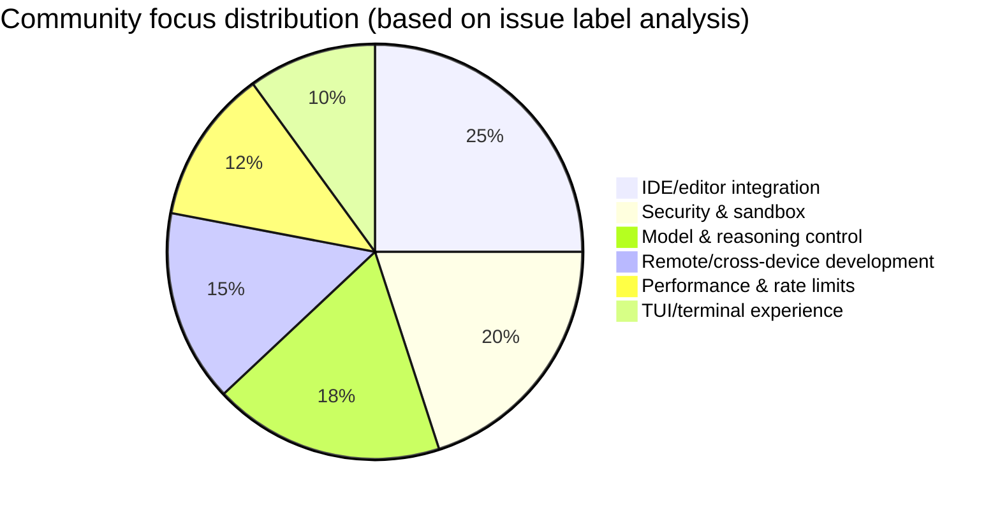

# AI CLI Community Report 2026-02-25

> Generated at: 2026-02-25 01:41 UTC | Tools covered: 6

- [Claude Code](https://github.com/anthropics/claude-code)
- [OpenAI Codex](https://github.com/openai/codex)
- [Gemini CLI](https://github.com/google-gemini/gemini-cli)
- [Kimi Code CLI](https://github.com/MoonshotAI/kimi-cli)
- [OpenCode](https://github.com/anomalyco/opencode)
- [Qwen Code](https://github.com/QwenLM/qwen-code)

---

## Side-by-side Comparison

# AI CLI Tools Ecosystem Comparison Report | 2026-02-25

---

## 1. Ecosystem Overview

The current AI CLI tool ecosystem shows a **"three leaders, many chasers"** pattern: Claude Code and OpenAI Codex hold first-mover advantages with enterprise-grade features and stability, Gemini CLI is pursuing differentiation through an aggressive Agent architecture rewrite, while Kimi CLI and OpenCode iterate rapidly on specific scenarios (enterprise network adaptation, multi-model compatibility). The overall technical direction is evolving from "standalone chat tools" toward "Multi-Agent orchestration platforms", with Windows stability, enterprise security and compliance, and remote development capabilities as shared priorities. Divergent technology choices — the Rust rewrite (Codex), Hook pluginization (Claude), and ReAct loop standardization (Gemini) — are shaping each tool's long-term architectural boundaries.

---

## 2. Activity Comparison by Tool

| Tool | Issues today | PRs today | Releases | Key developments |
|:---|:---:|:---:|:---|:---|
| **Claude Code** | 8 active (2 severe regressions) | 8 (3 merged) | v2.1.53 → v2.1.52 consecutive fixes | Severe Windows Bash tool regression; Hook ecosystem taking shape quickly |
| **OpenAI Codex** | 10 active (3 high-heat) | 10 (dense Rust iteration) | rust-v0.105.0-alpha.17/18 | Subagent configuration milestone landed; rate limit controversy heating up |
| **Gemini CLI** | 10 active | 10 (1 architecture-level) | v0.30.0-preview.6 / v0.29.7 | Agent v1 rewrite PR entered review; Plan Mode experience controversy |
| **Kimi CLI** | 6 active (4 connection failures) | 7 (1 core merge) | **v1.13.0** | Retriable Provider architecture released; Linux connection issues erupting |
| **OpenCode** | 10 active | 10 (feature-dense) | **v1.2.11** | Experimental workspace-serve feature; continued TUI performance optimization |
| **Qwen Code** | — | — | — | Data retrieval failed |

> **Activity ranking**: Codex ≈ Claude Code ≈ Gemini CLI ≈ OpenCode > Kimi CLI

---

## 3. Shared Feature Directions

| Feature direction | Tools involved | Specific requests |
|:---|:---|:---|
| **Windows platform stability** | Claude Code, Codex, Gemini CLI, OpenCode | Claude Bash tool EINVAL regression; Codex IDE extension lag; Gemini scroll flickering; OpenCode path/paste issues |
| **Enterprise network/security compliance** | Claude Code, Codex, Kimi CLI, OpenCode | Kimi SSL_CERT_FILE, Azure deployment; Codex sensitive file exclusion; Claude remote-control permissions; OpenCode Bedrock IAM |
| **Multi-Agent orchestration** | Codex, Gemini CLI, Claude Code | Codex subagent configuration (#11701 closed); Gemini Agent v1 rewrite (#19982); Claude batch Agent termination optimization |
| **Session persistence and recovery** | Claude Code, Gemini CLI, OpenCode | Claude sessions disappearing after logout; Gemini unclear exit/recovery path; OpenCode `/compact` data loss |
| **Rate limits and billing transparency** | Codex, Kimi CLI | Codex abnormal consumption of 22% of the weekly quota (#12728); Kimi 413 context over-limit |
| **Remote/cross-device development** | Codex, Claude Code, Gemini CLI | Codex SSH remote development (#10450); Claude `claude remote-control`; Gemini SSH tool (#19541) |

---

## 4. Differentiation Analysis

| Tool | Core feature focus | Target user profile | Technical approach |
|:---|:---|:---|:---|
| **Claude Code** | Enterprise collaboration (Cowork), Hook plugin ecosystem, deep VS Code integration | Mid-to-large teams, enterprise developers, those needing customized workflows | TypeScript-led, Hookify plugin system opened up, emphasizing "human-AI collaboration" over full automation |
| **OpenAI Codex** | Rust core performance, subagent orchestration, TUI interaction experience, multi-model scheduling | Performance-sensitive developers, Multi-Agent scenarios, deep OpenAI ecosystem users | **Full Rust rewrite**, Skills system security controls, refined Plan/Default dual modes |
| **Gemini CLI** | Agent architecture platformization, Plan Mode planning-execution separation, native Google ecosystem | Those pursuing "autopilot" coding, Google Cloud users, experimental feature enthusiasts | **ReAct loop standardization**, Agent v1 abstraction layer evolving toward an SDK, Conductor policy engine |
| **Kimi CLI** | Network resilience (retriable Provider), enterprise proxy adaptation, Wire-mode Agent control | Chinese enterprise users, complex network environments, those needing domestic Chinese model support | Rust (kosong framework), provider-level circuit breaking and degradation, emphasizing "usability on weak networks" |
| **OpenCode** | Multi-model compatibility (Kimi/Gemini/GPT-5/Devstral), TUI performance, open ecosystem | Multi-model strategy users, those chasing the latest model features, self-hosting needs | TypeScript, modular provider system, quickly tracking third-party model API changes |

---

## 5. Community Heat and Maturity

### Maturity matrix (based on issue handling efficiency + feature completeness)

| Tool | Community heat | Iteration speed | Stability | Docs/ecosystem | Overall maturity |
|:---|:---:|:---:|:---:|:---:|:---:|
| **Claude Code** | ⭐⭐⭐⭐⭐ | ⭐⭐⭐⭐☆ | ⭐⭐⭐☆☆* | ⭐⭐⭐⭐☆ | **High** (recently dragged down by Windows) |
| **OpenAI Codex** | ⭐⭐⭐⭐⭐ | ⭐⭐⭐⭐⭐ | ⭐⭐⭐⭐☆ | ⭐⭐⭐☆☆ | **Medium-high** (volatility during the Rust rewrite) |
| **Gemini CLI** | ⭐⭐⭐⭐☆ | ⭐⭐⭐⭐⭐ | ⭐⭐⭐☆☆ | ⭐⭐⭐☆☆ | **Medium** (architecture rewrite period) |
| **Kimi CLI** | ⭐⭐⭐☆☆ | ⭐⭐⭐⭐☆ | ⭐⭐⭐☆☆* | ⭐⭐⭐☆☆ | **Medium** (critical 1.13.0 upgrade) |
| **OpenCode** | ⭐⭐⭐⭐☆ | ⭐⭐⭐⭐⭐ | ⭐⭐⭐☆☆ | ⭐⭐⭐⭐☆ | **Medium-high** (feature catch-up period) |

*\* Severe regressions or concentrated failures today*

### Key judgments

- **Most active communities**: Claude Code (Hook ecosystem contributors emerging), OpenAI Codex (daily Rust rewrite iteration)
- **Fastest iteration phases**: Gemini CLI (Agent v1 architecture rewrite), OpenCode (intensive multi-model adaptation)
- **Stability risk periods**: Claude Code (v2.1.53 Windows regression), Kimi CLI (1.13.0 Linux connection failures)

---

## 6. Trend Signals Worth Watching

| Trend signal | Evidence | Reference value for developers |
|:---|:---|:---|
| **"Plan Mode" becomes standard, but experiences diverge** | Claude, Codex, and Gemini all have implementations; Gemini #20143 "too eager to jump into implementation" got the P1 label | When choosing a tool, verify: whether the planning-execution boundary is clear and whether user intervention points are sufficient |
| **Hook/plugin systems shift from "nice-to-have" to "must-have"** | Claude Hookify ecosystem (#28294 etc.), OpenCode's `.agents/skills/` standard path request | Evaluate the tool's extensibility architecture: whether it supports permission interception, field mapping, custom workflows |
| **Rust becomes the first choice for performance-sensitive CLIs** | Codex's full Rust rewrite, Kimi CLI built on the kosong Rust framework | Technology selection considerations: the team's Rust capability reserve and build toolchain maturity |
| **"Weak-network resilience" becomes a differentiator** | Kimi 1.13.0 retriable Provider, Claude session recovery anxiety | Before enterprise deployment, verify: automatic recovery mechanisms under network jitter |
| **Multi-model strategies push "provider abstraction layers" to maturity** | OpenCode's 10+ provider adaptations, Codex custom model metadata issues | Avoid vendor lock-in: choose tools with standardized provider interfaces |
| **Windows developer experience remains an industry weakness** | All 5 tools have Windows-specific issues, at significantly higher density than macOS/Linux | Cross-platform teams should reserve dedicated Windows testing resources or prefer WSL solutions |

---

*This report is based on public community data as of 2026-02-25; PoC validation against specific scenarios is recommended*

---

## Detailed Reports by Tool

<details>
<summary><strong>Claude Code</strong> — <a href="https://github.com/anthropics/claude-code">anthropics/claude-code</a></summary>

# Claude Code Community Report | 2026-02-25

## Today at a Glance

Today the community focused on two themes: a **severe Windows Bash tool regression** (multiple related issues erupting on v2.1.53), and the **VS Code extension command registration issue** that was emergency-fixed in v2.1.52. Meanwhile, misleading error messages from the remote-control feature (`claude remote-control`) for personal accounts sparked a UX controversy, with the community calling for clearer permission documentation.

---

## Releases

### v2.1.53 → v2.1.52 consecutive fixes
| Version | Key fixes |
|:---|:---|
| **v2.1.53** | Fixed UI flickering (brief disappearance after input submission), batch Agent termination notification aggregation, and graceful shutdown issues |
| **v2.1.52** | **Emergency fix**: VS Code extension crashing on Windows (`command 'claude-vscode.editor.openLast' not found`)|

🔗 [v2.1.53 Release](https://github.com/anthropics/claude-code/releases/tag/v2.1.53) | [v2.1.52 Release](https://github.com/anthropics/claude-code/releases/tag/v2.1.52)

> ⚠️ **Note**: v2.1.53 introduced a new Windows Bash tool regression; see the issues below.

---

## Community Hot Issues

### 🔴 Severe regressions (need immediate attention)

| # | Title | Status | Comments | Core problem |
|:---|:---|:---|:---:|:---|
| [#28333](https://github.com/anthropics/claude-code/issues/28333) | Bash tool completely broken on Windows: `EINVAL: invalid argument` | 🟡 OPEN | 6 | **Critical v2.1.53 regression** — every Bash command fails; temp file path creation is abnormal |
| [#28343](https://github.com/anthropics/claude-code/issues/28343) | Bash tool EINVAL persists — the v2.1.45 stdio fd regression was not fully fixed | 🟡 OPEN | 2 | Traces back to the v2.1.45 series of issues; Git Bash/Scoop install environments affected |
| [#28344](https://github.com/anthropics/claude-code/issues/28344) | `EINVAL` fails on non-C: drives | 🟢 CLOSED | 3 | Triggered when paths contain hyphens or cross drives; closed quickly but related issues persist |
| [#28347](https://github.com/anthropics/claude-code/issues/28347) | Bash fails when the working directory contains hyphens | 🟢 CLOSED | 2 | Similar to #28344; downgrading to v2.1.52 restores functionality |

### 🔶 High-interaction topics

| # | Title | Status | Comments/👍 | Community focus |
|:---|:---|:---|:---:|:---|
| [#26805](https://github.com/anthropics/claude-code/issues/26805) | Cowork UI: responses not rendering, "working through complex response" hangs forever | 🟢 CLOSED | 44/24 | **Resolved** — a core collaboration-mode experience issue; the fix was well received by the community |
| [#20696](https://github.com/anthropics/claude-code/issues/20696) | Conversation compression intermittently fails or deadlocks (regression after January 15) | 🟡 OPEN | 36/8 | **Long-standing ailment** — affects claude.ai web/mobile; a cross-platform context management crisis |
| [#28098](https://github.com/anthropics/claude-code/issues/28098) | `claude remote-control` shows a misleading "contact your administrator" error for personal accounts | 🟡 OPEN | 21/14 | **UX design flaw** — Pro/Max users have no administrator to contact; the permission model is unclear |
| [#21576](https://github.com/anthropics/claude-code/issues/21576) | Task execution escapes into PowerShell and becomes unresponsive | 🟡 OPEN | 21/1 | Windows platform stability; task execution flow out of control |
| [#26452](https://github.com/anthropics/claude-code/issues/26452) | Sessions disappear after logout/restart — how to recover urgently? | 🟡 OPEN | 20/8 | **Data safety anxiety** — the session persistence mechanism is being questioned |
| [#26638](https://github.com/anthropics/claude-code/issues/26638) | Desktop app crashes after launch; 8 claude.exe processes unresponsive | 🟢 CLOSED | 14/31 | Windows multi-process architecture stability issue; the high 👍 count reflects widespread impact |

---

## Notable PR Progress

| # | Title | Status | Core contribution |
|:---|:---|:---|:---|
| [#28294](https://github.com/anthropics/claude-code/pull/28294) | Add a PermissionRequest Hook workaround for piped command permissions | 🟡 OPEN | Resolves the regression where Plan Agent still prompts for permissions on whitelisted piped commands; provides `examples/hooks/piped_command_permission_fix.py` |
| [#28065](https://github.com/anthropics/claude-code/pull/28065) | Batch-fix small open PRs (Hookify field mapping, Python 3.8 compatibility, etc.) | 🟡 OPEN | Consolidates community contributions like #24321: fixes Write/Edit field mapping, `|` union type syntax, and undefined variable references |
| [#28062](https://github.com/anthropics/claude-code/pull/28062) | Batch-fix actionable community PRs (Hookify import paths, etc.) | 🟡 OPEN | Consolidates #27796: changes `hookify.core.*` to `core.*`, resolving the `No module named 'hookify'` error |
| [#28088](https://github.com/anthropics/claude-code/pull/28088) | Fix incorrect Python import paths in hookify plugins | 🟢 CLOSED | Resolves absolute import failures under the `CLAUDE_PYTHON_PATH` environment |
| [#28243](https://github.com/anthropics/claude-code/pull/28243) | Add a non-write users check workflow | 🟢 CLOSED | Security enhancement: detects changes to `allowed_non_write_users` and triggers a security review comment |
| [#27911](https://github.com/anthropics/claude-code/pull/27911) | Use a wrapper script for label operations in issue triage | 🟢 CLOSED | Extracts the triage prompt into a `/triage-issue` command, replaces raw `gh issue edit` with `edit-issue-labels.sh`, with label validation |
| [#26565](https://github.com/anthropics/claude-code/pull/26565) | Claude/general session dg oce | 🟡 OPEN | Session management related (details to be added)|
| [#28355](https://github.com/anthropics/claude-code/pull/28355) | Add files via upload | 🟡 OPEN | Content to be clarified (new commits)|

---

## Feature Request Trends

Based on an analysis of 50 active issues, community priorities:

```
1. [Stability] Windows platform toolchain reliability   ████████████████████  Explosive growth
2. [Core experience] Conversation compression and context management  ████████████████░░░░░  Long-standing pain point
3. [IDE integration] VS Code extension robustness       ██████████████░░░░░░░  Recently urgent
4. [Permission model] Remote control and account system clarity  ██████████░░░░░░░░░░░  New-feature friction
5. [Data safety] Session persistence and recovery       █████████░░░░░░░░░░░░  User anxiety
6. [Cross-platform] WSL support (advanced Windows users) ██████░░░░░░░░░░░░░░░  Differentiated need
```

**Emerging trend**: A plugin ecosystem around the Hook system (`hookify`) is forming, with community contributions concentrating on extension points such as permission interception, field mapping, and import paths.

---

## Developer Concerns

### 🔥 Immediate pain points
| Problem | Impact scope | Workaround |
|:---|:---|:---|
| **Bash tool EINVAL** | Windows v2.1.53 users | **Downgrade to v2.1.52** |
| **VS Code command not found** | Windows extension users | Update to v2.1.52+ |
| **Session loss** | Desktop users | Avoid manual logout; watch autosave status |

### 📣 Frequent requests
1. **More transparent release notes** — the v2.1.53 Bash regression was not flagged in the changelog
2. **A dedicated Windows QA process** — recent Windows-specific bug density is significantly higher than macOS/Linux
3. **Remote-control permission docs** — the capability boundary between personal and enterprise accounts needs clear distinction
4. **Hook development docs** — the plugin system is growing fast while official best-practice guides are missing
5. **Conversation compression visibility** — users want to know when/how compression happens instead of passively accepting it

### 💡 Technical debt signals
- Temp file path handling (`C:\Users\...\AppData\Local\Temp\claude\...`) has repeatedly shown encoding/special-character issues on Windows
- `tmux` integration has race conditions in team Agent scenarios (shell initialization timing)
- The cost metering metric (`cost_usage_total`) has model pricing mapping errors, undermining enterprise users' trust in billing

---

*This report is generated from public GitHub data and does not represent Anthropic's official position.*

</details>

<details>
<summary><strong>OpenAI Codex</strong> — <a href="https://github.com/openai/codex">openai/codex</a></summary>

# OpenAI Codex Community Report | 2026-02-25

## Today at a Glance

Today the community focused on the **Rust core rewrite** and **multi-platform stability fixes**. Two Rust alpha versions (v0.105.0-alpha.17/18) were released back to back, while TUI keyboard compatibility, sandbox permission control, and the model switching experience became PR focal points. On the issue side, abnormal rate-limit consumption and remote development demand kept heating up.

---

## Releases

### rust-v0.105.0-alpha.18 & alpha.17
| Version | Release date |
|:---|:---|
| [v0.105.0-alpha.18](https://github.com/openai/codex/releases/tag/rust-v0.105.0-alpha.18) | 2026-02-25 |
| [v0.105.0-alpha.17](https://github.com/openai/codex/releases/tag/rust-v0.105.0-alpha.17) | 2026-02-25 |

> Note: The release notes are brief; specific changes need to be analyzed via the PRs. Based on the associated PRs, they mainly involve musl build fixes, OAuth permission adjustments, and a rework of the shell permission escalation mechanism.

---

## Community Hot Issues (Top 10)

| # | Status | Topic | Heat | Key takeaways |
|:---|:---|:---|:---|:---|
| [#11701](https://github.com/openai/codex/issues/11701) | ✅ CLOSED | Subagent configuration and orchestration | 👍38 / 💬60 | **Milestone feature landed**: supports configuring subagent models and reasoning effort via `~/.codex/config.toml`; the long-requested Multi-Agent orchestration capability is now usable |
| [#2847](https://github.com/openai/codex/issues/2847) | 🟡 OPEN | Sensitive file exclusion mechanism | 👍214 / 💬54 | **Security necessity**: the tension between searching and privacy protection for directories like `node_modules/`; the community suggests a dual-track `.codexignore` + global ignore approach |
| [#2558](https://github.com/openai/codex/issues/2558) | 🟡 OPEN | Zellij terminal scroll truncation | 👍76 / 💬35 | **Terminal compatibility**: TUI rendering issues inside terminal multiplexers, affecting mainstream development workflows |
| [#10450](https://github.com/openai/codex/issues/10450) | 🟡 OPEN | Desktop SSH remote development | 👍189 / 💬25 | **Migration barrier for VS Code users**: Codex Desktop lacks a Remote-SSH equivalent, blocking server-side development scenarios |
| [#12674](https://github.com/openai/codex/issues/12674) | ✅ CLOSED | Rate limit false triggers | 👍15 / 💬15 | **Server-side issue**: 429 errors occurring with ample quota left; officially closed after a quick response |
| [#12092](https://github.com/openai/codex/issues/12092) | 🟡 OPEN | Desktop auto-scroll broken | 👍12 / 💬13 | **Regression bug**: degraded experience after the v26.217.1959 update, affecting long-conversation browsing |
| [#12100](https://github.com/openai/codex/issues/12100) | ✅ CLOSED | Missing custom model metadata | 👍3 / 💬17 | **OCA ecosystem**: `oca/gpt-5-codex` model identification issues; a third-party provider integration pain point |
| [#10571](https://github.com/openai/codex/issues/10571) | 🟡 OPEN | Mysterious "Bad request" errors | 👍1 / 💬13 | **Hard to diagnose**: errors in specific GPT-5.2 xhigh scenarios with no useful error information |
| [#9224](https://github.com/openai/codex/issues/9224) | 🟡 OPEN | CLI remote control | 👍30 / 💬8 | **Cross-device collaboration**: controlling desktop Codex CLI from the phone ChatGPT App; a community workaround already exists |
| [#12728](https://github.com/openai/codex/issues/12728) | 🟡 OPEN | Abnormal rate-limit consumption | 👍0 / 💬3 | **Billing anxiety**: users report 22% of the weekly quota consumed in a single day with unchanged usage patterns, suspected background billing changes |

---

## Notable PR Progress (Top 10)

| # | Author | Core change | Technical value |
|:---|:---|:---|:---|
| [#12706](https://github.com/openai/codex/pull/12706) | @charley-oai | **Enable `request_user_input` in Default mode** | Breaks Plan mode's exclusive interaction; Default mode can now also proactively ask the user |
| [#12730](https://github.com/openai/codex/pull/12730) | @bolinfest | **Shell escalation check Skill policy** | Security hardening: Skill script execution now requires explicit user approval, preventing silent privilege escalation |
| [#12719](https://github.com/openai/codex/pull/12719) | @bolinfest | **Arg0DispatchPaths passes the helper executable path** | Removes the fragility of `PATH` scanning, improving cross-environment reliability |
| [#12727](https://github.com/openai/codex/pull/12727) | @charley-oai | **TUI resume/fork resolves via thread_id** | Makes session management precise, resolving working-directory ambiguity in multi-thread scenarios |
| [#12725](https://github.com/openai/codex/pull/12725) | @fjord-oai | **Fix image attachments in nested tool calls in js_repl** | Restores the expected behavior of `view_image` in the JS REPL |
| [#12720](https://github.com/openai/codex/pull/12720) | @sayan-oai | **Add `AWS_LC_SYS_NO_JITTER_ENTROPY=1` to musl builds** | Emergency fix for the Rust release pipeline, unblocking the jitterentropy link failure |
| [#12715](https://github.com/openai/codex/pull/12715) | @aibrahim-oai | **App-server v2 realtime conversation API** | Experimental realtime session API, paving the way for voice/streaming interaction |
| [#12703](https://github.com/openai/codex/pull/12703) | @fcoury | **Ctrl+O quick switch to recent models** | Experience improvement: demand for fast/slow model switching surged after the 5.3-spark release |
| [#12702](https://github.com/openai/codex/pull/12702) | @viyatb-oai | **macOS Seatbelt network and Unix socket handling improvements** | Finer sandbox security: dual-stack local binding + explicit AF_UNIX permissions |
| [#12660](https://github.com/openai/codex/pull/12660) | @alexsong-oai | **External agent configuration detection and import** | Ecosystem interoperability: automatically detects and imports third-party Agent configurations |

---

## Feature Request Trends



**Three main threads**:
1. **Enterprise-grade security** — sensitive file isolation (#2847), finer sandbox permissions (#12702), Skill execution control (#12730)
2. **Flexible model scheduling** — subagent orchestration (#11701), quick model switching (#12703), custom model metadata (#12380)
3. **Closed-loop remote development** — SSH remote hosts (#10450), CLI remote control (#9224), cross-device session sync

---

## Developer Concerns

| Pain point | Representative issues | Community requests |
|:---|:---|:---|
| **Rate limit black box** | #12674, #12728, #4095 | Visualize quota consumption; make abnormal billing disputable |
| **Opaque error messages** | #10571, #12114 | Errors like "Bad request" should include detailed context |
| **Windows as a second-class citizen** | #12161, #12673 | IDE extension lag and build hangs cluster here |
| **Context window anxiety** | #9046, #11440 | Graceful degradation after 413/context exhaustion |
| **Third-party ecosystem compatibility** | #12100, #12114, #12669 | Support for unofficial endpoints such as OpenRouter and vLLM |

---

*This report is generated from public GitHub data and does not represent OpenAI's official position.*

</details>

<details>
<summary><strong>Gemini CLI</strong> — <a href="https://github.com/google-gemini/gemini-cli">google-gemini/gemini-cli</a></summary>

# Gemini CLI Community Report | 2026-02-25

---

## 1. Today at a Glance

Today the community focused on **Plan Mode experience improvements** and **Agent architecture evolution**: the dual releases of v0.30.0-preview.6 and v0.29.7 shipped key patches, while the core Agent v1 rewrite PR entered review. Developers frequently reported Plan Mode being "too eager to jump into implementation" along with interaction polish issues, showing that feature maturity remains the top priority.

---

## 2. Releases

| Version | Type | Core updates |
|:---|:---|:---|
| **[v0.30.0-preview.6](https://github.com/google-gemini/gemini-cli/releases/tag/v0.30.0-preview.6)** | Preview patch | Cherry-pick fix for d96bd05, continuing preview.5's stability improvements |
| **[v0.30.0-nightly.20260224](https://github.com/google-gemini/gemini-cli/releases/tag/v0.30.0-nightly.20260224.544df749a)** | Nightly build | Core refactor: session conversion logic moved to the core layer; fixed manual model selection not persisting across restarts |
| **[v0.29.7](https://github.com/google-gemini/gemini-cli/releases/tag/v0.29.7)** | Stable patch | Same fixes as preview.6, targeting the v0.29 stable branch |

> **Note**: The "Persist manual model selection on restart" fix included in v0.30.0-nightly also resolves the configuration loss the community has long complained about.

---

## 3. Community Hot Issues

| # | Title | Priority | Comments | Key value |
|:---|:---|:---|:---:|:---|
| [#20142](https://github.com/google-gemini/gemini-cli/issues/20142) | AskUser open questions don't support Ctrl+R history search | need-triage | 8 | **High-frequency interaction pain point**: users cannot quickly recall previous input in long conversations, severely hurting multi-turn task efficiency |
| [#20143](https://github.com/google-gemini/gemini-cli/issues/20143) | Plan Mode is too eager to jump into implementation | **P1** | 5 | **Core experience flaw**: the Agent jumps to coding before planning is finished, breaking the "plan first, then execute" design intent |
| [#20177](https://github.com/google-gemini/gemini-cli/issues/20177) | AskUser used to confirm shell commands instead of the standard tool confirmation | need-triage | 4 | **Interaction consistency**: breaks the user's mental model and adds cognitive load |
| [#20181](https://github.com/google-gemini/gemini-cli/issues/20181) | AskUser open questions need external editor support | need-triage | 3 | A hard requirement for long-text input scenarios (e.g., Conductor track descriptions) |
| [#19514](https://github.com/google-gemini/gemini-cli/issues/19514) | AskUser outputs raw tags in Plan Mode | area/core | 3 | A rendering-layer bug that directly hurts Plan Mode readability |
| [#18953](https://github.com/google-gemini/gemini-cli/issues/18953) | Complex shell commands execute extremely slowly | **P2** | 3 | Performance bottleneck: "UX magic" like progress bars causes a 100x slowdown, blocking enterprise scenarios |
| [#18896](https://github.com/google-gemini/gemini-cli/issues/18896) | Windows screen flickers/glitches while scrolling | **P2** | 3 | Cross-platform stability issue; the core experience is damaged for Windows users |
| [#20195](https://github.com/google-gemini/gemini-cli/issues/20195) | [Agents] Local Subagent Sprint 1 | area/agent | 2 | **Architecture milestone**: infrastructure for multi-Agent collaboration is underway |
| [#20233](https://github.com/google-gemini/gemini-cli/issues/20233) | Experimental separation of remote and local Subagents | need-triage | 1 | Isolation design for security and experimental features, shaping the future extension architecture |
| [#20219](https://github.com/google-gemini/gemini-cli/issues/20219) | Terminal snapshot tests need color support | need-triage | 1 | Engineering quality: prevents color regressions and supports the new renderer migration |

---

## 4. Notable PR Progress

| # | Title | Status | Core contribution |
|:---|:---|:---|:---|
| [#19982](https://github.com/google-gemini/gemini-cli/pull/19982) | Agent & AgentSession v1: ReAct loop and event stream | **OPEN** | **Architectural cornerstone**: the first reusable Agent abstraction layer, supporting SDK-style invocation and fine-grained event observation |
| [#20082](https://github.com/google-gemini/gemini-cli/pull/20082) | Interactive shell autocompletion | OPEN | Readline-like Tab completion covering files/directories/command paths, boosting terminal efficiency |
| [#20220](https://github.com/google-gemini/gemini-cli/pull/20220) | Snapshot tests with color information | OPEN | SVG snapshots capture ANSI colors, closing a regression-testing blind spot (related to #20219) |
| [#19541](https://github.com/google-gemini/gemini-cli/pull/19541) | Built-in SSH tool for remote device access | OPEN | Executes remote commands directly and analyzes output in real time, expanding DevOps scenarios |
| [#19812](https://github.com/google-gemini/gemini-cli/pull/19812) | Headless auto mode (/auto alias for /headless) | OPEN | Runs one-shot headless tasks inside an interactive session, auto-skipping confirmations and exiting |
| [#20229](https://github.com/google-gemini/gemini-cli/pull/20229) | Parallel extension loading optimization | OPEN | ExtensionManager loads extensions concurrently, significantly improving startup performance with many extensions |
| [#19389](https://github.com/google-gemini/gemini-cli/pull/19389) | Hide thinking shortcut hints + debounce anti-flicker | OPEN | Resolves visual interference in alternate buffer mode |
| [#19365](https://github.com/google-gemini/gemini-cli/pull/19365) | MCP tool output truncation + Unicode safety | OPEN | Prevents large outputs from blowing up the context; safe truncation for multi-byte characters |
| [#20244](https://github.com/google-gemini/gemini-cli/pull/20244) | Arch Linux (pacman) installation docs | OPEN | Community contribution: better Linux distribution coverage |
| [#20240](https://github.com/google-gemini/gemini-cli/pull/20240) | Plan Mode automatic model switching | **CLOSED** | Routing strategy using Pro during planning and Flash during implementation (merged or closed) |

---

## 5. Feature Request Trends

Cluster analysis of 50 active issues:

| Trend direction | Heat | Typical requests |
|:---|:---:|:---|
| **Fine-grained Plan Mode control** | 🔥🔥🔥 | Pacing control (avoiding premature implementation), editor integration, history search, tag rendering fixes |
| **Agent architecture expansion** | 🔥🔥🔥 | Local/remote Subagent separation, multi-Agent collaboration, ReAct loop standardization |
| **Terminal interaction experience** | 🔥🔥🔥 | Scrolling performance (Windows flicker), color testing, debouncing, autocompletion |
| **Context and performance optimization** | 🔥🔥 | Large output truncation, token-frugal reading (Tactful Extraction), smart pagination |
| **Headless/CI integration** | 🔥🔥 | Policy engine headless support, auto mode, session recovery guidance |
| **Extension and policy ecosystem** | 🔥 | Parallel extension loading, policy file packaging, Conductor policy support |

---

## 6. Developer Concerns

### 🔴 Frequent pain points
1. **Plan Mode mental burden**: "the Agent rushes to write code" (#20143) coexists with "repeatedly asking whether to enter Plan Mode" (#19312), showing the state machine logic needs recalibration
2. **Windows second-class experience**: rendering issues such as scroll flickering (#18896) and path input flickering (#20217) are erupting in clusters
3. **Long-task black box**: no intelligent handling when shell command output is too large, causing apparent hangs or false loop-detection triggers (#19519, #19520)

### 🟡 Capability gaps
- **Session continuity**: the recovery path after exit is unclear (#19379), affecting long-running development workflows
- **Model selection persistence**: fixed (v0.30.0-nightly), but the historical debt shows configuration management still needs hardening

### 🟢 Positive signals
- The **Agent v1 architecture** (#19982) and **Subagent Sprint** (#20195) show the team shifting from "piling up features" to "platformized architecture"
- **Active community contributions**: PRs such as the SSH tool, Arch installation guide, and autocompletion reflect ecosystem expansion momentum

---

*This report is generated from github.com/google-gemini/gemini-cli data as of 2026-02-25*

</details>

<details>
<summary><strong>Kimi Code CLI</strong> — <a href="https://github.com/MoonshotAI/kimi-cli">MoonshotAI/kimi-cli</a></summary>

# Kimi Code CLI Community Report | 2026-02-25

---

## 1. Today at a Glance

**Kimi CLI 1.13.0 is officially released**. The core upgrade is a retriable Chat Provider interface with an automatic recovery mechanism, significantly improving reliability on unstable networks. The community today concentrated on reporting **Linux connection errors**, with multiple issues pointing to HTTP header pollution or enterprise proxy environment compatibility; the related fix PR has been submitted and is awaiting review.

---

## 2. Releases

### [v1.13.0](https://github.com/MoonshotAI/kimi-cli/releases/tag/1.13.0) | 2026-02-24

| Component | Version |
|:---|:---|
| kimi-cli | 1.12.0 → **1.13.0** |
| kimi-code | synced to 1.13.0 |
| kosong | 0.42.0 → **0.43.0** |

**Core updates:**
- **Retriable Chat Provider interface** ([#1219](https://github.com/MoonshotAI/kimi-cli/pull/1219)): implements provider-level automatic retry and failure recovery, reducing conversation interruptions caused by transient network fluctuations
- Dependencies upgraded to kosong 0.43.0

---

## 3. Community Hot Issues

| # | Title | Status | Key information |
|:---|:---|:---|:---|
| [#1217](https://github.com/MoonshotAI/kimi-cli/issues/1217) | Image processing hangs | 🔴 Open | **v1.12.0 / macOS ARM**; a multimodal scenario blocker affecting image input workflows |
| [#1227](https://github.com/MoonshotAI/kimi-cli/issues/1227) | LLM provider error: Connection error | 🔴 Open | **v1.13.0 / Ubuntu 22.04**; still occurring after the new release, needs regression investigation |
| [#1226](https://github.com/MoonshotAI/kimi-cli/issues/1226) | LLM provider error: Connection error | 🔴 Open | Same as above; fails even with verified configuration, suspected network-layer or authentication-layer issue |
| [#1220](https://github.com/MoonshotAI/kimi-cli/issues/1220) | HTTP headers polluted by the Ubuntu kernel version string | 🔴 Open | **Root-cause analysis**; `Linux 6.8.0-100-generic` injected into headers breaks protocol parsing; related fix in [#1229](https://github.com/MoonshotAI/kimi-cli/pull/1229) |
| [#1224](https://github.com/MoonshotAI/kimi-cli/issues/1224) | Unusable inside JetBrains IDEA | 🔴 Open | IDE integration scenario; v25.3.2 compatibility issue; screenshots pending |
| [#1222](https://github.com/MoonshotAI/kimi-cli/issues/1222) | 413 Request Entity Too Large | 🔴 Open | **v1.12.0 / Linux**; context or file upload size over the limit; needs a chunking strategy optimization |

**Trend assessment**: of today's 6 active issues, **4 are connection/network-layer failures**, concentrated on Linux and coinciding with the 1.13.0 release; the HTTP client changes introduced by the version upgrade should be investigated first.

---

## 4. Notable PR Progress

| # | Title | Status | Feature/fix highlights |
|:---|:---|:---|:---|
| [#1219](https://github.com/MoonshotAI/kimi-cli/pull/1219) | Retriable Chat Provider interface and recovery mechanism | ✅ Merged | **Core architecture upgrade**: the provider layer implements exponential backoff retries, circuit breaking/degradation, and state recovery |
| [#1221](https://github.com/MoonshotAI/kimi-cli/pull/1221) | Version bump to 1.13.0 | ✅ Merged | Release pipeline; synced kosong 0.43.0 |
| [#1229](https://github.com/MoonshotAI/kimi-cli/pull/1229) | Fix h11 rejection caused by whitespace in HTTP header values | 🔍 Open | **Urgent fix**: applies `strip()` to header values, directly addressing [#1220](https://github.com/MoonshotAI/kimi-cli/issues/1220) |
| [#1228](https://github.com/MoonshotAI/kimi-cli/pull/1228) | Wire mode adds steer support | 🔍 Open | **Agent control enhancement**: a JSON-RPC method injects user instructions, using a synthetic tool result mechanism to keep the chain of thought coherent |
| [#1223](https://github.com/MoonshotAI/kimi-cli/pull/1223) | Azure Kimi supports default_query/custom_headers | 🔍 Open | **Enterprise deployment**: an OpenAI compatibility layer extension supporting Azure custom query parameters and headers |
| [#762](https://github.com/MoonshotAI/kimi-cli/pull/762) | Support the SSL_CERT_FILE environment variable | 🔍 Open | **Enterprise proxies**: certificate trust issues in Zscaler/BlueCoat/Fortinet environments |
| [#1218](https://github.com/MoonshotAI/kimi-cli/pull/1218) | Add a bell_on_completion configuration | 🔍 Open | **UX enhancement**: plays an `\a` bell when a task completes, on par with Codex/Claude CLIs and suited to tmux multi-window setups |
| [#1225](https://github.com/MoonshotAI/kimi-cli/pull/1225) | Docs: add explanations of the three usage modes | 🔍 Open | Structured introduction to the three interaction forms: Interactive CLI / Kimi Web / Kimi ACP |

---

## 5. Feature Request Trends

Based on recent community feedback, three directions are heating up:

| Direction | Representative issues/PRs | Demand intensity |
|:---|:---|:---:|
| **Enterprise network environment adaptation** | [#762](https://github.com/MoonshotAI/kimi-cli/pull/762) [#1223](https://github.com/MoonshotAI/kimi-cli/pull/1223) [#1229](https://github.com/MoonshotAI/kimi-cli/pull/1229) | ⭐⭐⭐⭐⭐ |
| **Deep IDE integration** | [#1224](https://github.com/MoonshotAI/kimi-cli/issues/1224) JetBrains issue | ⭐⭐⭐⭐☆ |
| **Agent observability and control** | [#1228](https://github.com/MoonshotAI/kimi-cli/pull/1228) steer instructions [#1218](https://github.com/MoonshotAI/kimi-cli/pull/1218) completion notifications | ⭐⭐⭐⭐☆ |
| **Multimodal stability** | [#1217](https://github.com/MoonshotAI/kimi-cli/issues/1217) image hangs | ⭐⭐⭐☆☆ |

---

## 6. Developer Concerns

### 🔴 Frequent pain points

1. **Linux connection stability** (erupted today)
   - Symptom: after upgrading to v1.13.0, Ubuntu users report `Connection error` in clusters
   - Suspected root cause: an HTTP header handling change conflicting with the kernel version string
   - Progress: fix submitted in [#1229](https://github.com/MoonshotAI/kimi-cli/pull/1229), awaiting merge

2. **Enterprise proxy/certificate configuration**
   - Long-standing needs: SSL_CERT_FILE support, custom headers, Azure deployment
   - Progress: multiple PRs moving in parallel, but [#762](https://github.com/MoonshotAI/kimi-cli/pull/762) has been stalled for nearly 1 month

3. **Context size management**
   - [#1222](https://github.comgithub.com/MoonshotAI/kimi-cli/issues/1222) the 413 error reflects the lack of automatic chunking for large files/long conversations

### 🟡 Experience improvement requests

- **Async task awareness**: completion notifications when running under tmux/in the background (the [#1218](https://github.com/MoonshotAI/kimi-cli/pull/1218) proposal is awaiting review)
- **Agent intervention capability**: injecting instructions mid-run instead of restarting the session (the [#1228](https://github.com/MoonshotAI/kimi-cli/pull/1228) steer mechanism)

---

*Generated at: 2026-02-25* \
*Data source: github.com/MoonshotAI/kimi-cli*

</details>

<details>
<summary><strong>OpenCode</strong> — <a href="https://github.com/anomalyco/opencode">anomalyco/opencode</a></summary>

# OpenCode Community Report | 2026-02-25

---

## Today at a Glance

Today OpenCode released v1.2.11, adding the experimental `workspace-serve` command and fixing multiple Windows compatibility issues. Community discussion heated up around Kimi K2 series model integration failures on AWS Bedrock, TUI performance optimization needs, and proposals to improve the session data storage architecture.

---

## Releases

### v1.2.11
| Attribute | Details |
|:---|:---|
| Release date | 2026-02-24 |
| Core updates | • Added the `workspace-serve` command (experimental)<br>• ACP realtime and load-sharing synthetic pending states<br>• Replaced `structuredClone` with the spread operator for `process.env` in test environments<br>• Added 50ms tolerance to Windows NTFS mtime precision assertions |

---

## Community Hot Issues

| # | Title | Status | Comments | Key value |
|:---|:---|:---|:---|:---|
| [#1505](https://github.com/anomalyco/opencode/issues/1505) | Shift+Enter keybinding broken | 🔴 CLOSED | 114 | **Highest-heat fix**: a core TUI input interaction issue; 88 👍 reflect strong user attention |
| [#2987](https://github.com/anomalyco/opencode/issues/2987) | `/compact` command wipes all sessions | 🟡 OPEN | 27 | **Data safety red line**: a reliability flaw in session persistence; user data at risk |
| [#4832](https://github.com/anomalyco/opencode/issues/4832) | Gemini 3 Pro function calls missing `thoughtSignature` | 🔴 CLOSED | 24 | Model capability adaptation: follow-up support for new Google model features |
| [#14334](https://github.com/anomalyco/opencode/issues/14334) | v1.2.7 black screen issue | 🟡 OPEN | 19 | Desktop stability: cross-platform (Mac/Windows) rendering failures |
| [#11210](https://github.com/anomalyco/opencode/issues/11210) | Kimi K2 via Bedrock execution interruptions | 🟡 OPEN | 16 | Chinese model integration: null ContentBlock handling in the AWS Bedrock adaptation |
| [#13807](https://github.com/anomalyco/opencode/issues/13807) | Kimi K2.5 Bedrock premature `end_turn` | 🟡 OPEN | 13 | Broken tool call chain: Converse API parsing defects causing multi-turn tool call failures |
| [#5474](https://github.com/anomalyco/opencode/issues/5474) | `/undo` rolls back messages but not files | 🟡 OPEN | 12 | State consistency: missing atomicity between conversation and file system operations |
| [#10986](https://github.com/anomalyco/opencode/issues/10986) | Support the `.agents/skills/` standard path | 🟡 OPEN | 11 | Ecosystem standardization: community consensus advancing the Agent Skills directory convention |
| [#13546](https://github.com/anomalyco/opencode/issues/13546) | GPT-5 series `reasoningSummary` parameter compatibility | 🟡 OPEN | 7 | Third-party provider adaptation: the OpenAI compatibility layer injects parameters too aggressively |
| [#13838](https://github.com/anomalyco/opencode/issues/13838) | Compression replay injects fake user messages | 🟡 OPEN | 4 | Context pollution: the `/compact` mechanism introduces unexpected model behavior |

---

## Notable PR Progress

| # | Title | Author | Type | Core contribution |
|:---|:---|:---|:---|:---|
| [#14974](https://github.com/anomalyco/opencode/pull/14974) | Upgrade opentui to v0.1.82 and enable Markdown rendering by default | @kommander | Feature | TUI experience upgrade: Markdown visualization enabled by default |
| [#13968](https://github.com/anomalyco/opencode/pull/13968) | Separate TUI/Server configuration | @kommander | Architecture | Decouples server and client configuration, improving deployment flexibility |
| [#14987](https://github.com/anomalyco/opencode/pull/14987) | JSON escaping for config environment variable placeholders | @chindris-mihai-alexandru | Fix | Resolves `#14986`: special characters breaking config parsing |
| [#14969](https://github.com/anomalyco/opencode/pull/14969) | Bedrock IAM credential connection flow | @tristan-stahnke-GPS | Fix | Replaces the API Key form, supporting standard AWS IAM authentication |
| [#14647](https://github.com/anomalyco/opencode/pull/14647) | Block Copilot 400 on empty tool descriptions | @amsminn | Fix | Request failures caused by empty descriptions of MCP/OpenAI-compatible tools |
| [#14515](https://github.com/anomalyco/opencode/pull/14515) | Add the `/experimental` slash command | @aravhawk | Feature | Quickly toggles experimental feature flags, lowering the configuration barrier |
| [#14975](https://github.com/anomalyco/opencode/pull/14975) | Status panel shows exact plugin versions | @LukeCarrier | Feature | Resolves `#14976`: precise version numbers for easier debugging |
| [#14958](https://github.com/anomalyco/opencode/pull/14958) | SAP AI provider Gemini 2.5 thinkingConfig | @jerome-benoit | Fix | Aligns with the Anthropic/Gemini reasoning parameter naming conventions |
| [#14973](https://github.com/anomalyco/opencode/pull/14973) | Fix OpenAI-compatible provider loop termination after tool calls | @valenvivaldi | Fix | Resolves `#14972`/`#14063`: the `finish_reason` misjudgment issue |
| [#10275](https://github.com/anomalyco/opencode/pull/10275) | Automatic provider package cleanup tracking | @jerome-benoit | Feature | Reference-counting mechanism that improves dependency package lifecycle management |

---

## Feature Request Trends

Based on an analysis of 50 active issues, community focus shows the following gradient:

| Priority | Direction | Typical issues | Driving force |
|:---|:---|:---|:---|
| 🔥 P0 | **Model ecosystem expansion** | Kimi K2/K2.5, Gemini 2.5/3, GPT-5, Devstral 2 | Multi-model strategies and Chinese model adoption |
| 🔥 P0 | **TUI performance and stability** | Slow startup, stuttering stream rendering, black screens, keybinding conflicts | The core bottleneck of the daily development experience |
| P1 | **Session and state management** | Data persistence, `/compact` reliability, `/undo` atomicity | Data safety for long-session workflows |
| P1 | **Enterprise-grade integration** | Bedrock IAM, SAP AI, Alibaba Cloud Model Studio | Authentication and compliance needs for B2B deployment |
| P2 | **Configuration and ecosystem standards** | `.agents/skills/` path, improved MCP documentation | Toolchain interoperability |

---

## Developer Concerns

### 🔴 Frequent pain points

| Problem domain | Specific symptoms | Impact |
|:---|:---|:---|
| **AWS Bedrock adaptation** | Null ContentBlock in the Kimi series, premature `end_turn`, missing IAM credential flow | The main deployment channel for enterprise users |
| **Windows compatibility** | Update failures, path resolution, broken paste, NTFS time precision | The baseline experience for cross-platform users |
| **Session data reliability** | `/compact` causing data loss, zero cache hit rate, opaque storage locations | A trust crisis for long-running projects |

### 🟡 Emerging needs

- **Localized deployment optimization**: Ollama Modelfile template best practices (#10824)
- **Version observability**: showing exact plugin version numbers (#14976 → #14975)
- **Interaction efficiency**: ESC key navigation, Home/End key unbinding (#14931, #14962)

---

*Data source: github.com/anomalyco/opencode | Statistics window: 2026-02-24 to 2026-02-25*

</details>

<details>
<summary><strong>Qwen Code</strong> — <a href="https://github.com/QwenLM/qwen-code">QwenLM/qwen-code</a></summary>

⚠️ Summary generation failed.

</details>

---
*This report was auto-generated by [agents-radar](https://github.com/duanyytop/agents-radar).*