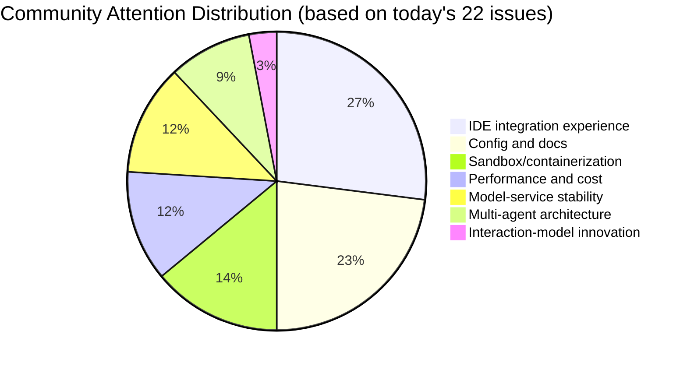

# AI CLI Community Report 2026-02-27

> Generated at: 2026-02-27 00:09 UTC | Tools covered: 6

- [Claude Code](https://github.com/anthropics/claude-code)
- [OpenAI Codex](https://github.com/openai/codex)
- [Gemini CLI](https://github.com/google-gemini/gemini-cli)
- [Kimi Code CLI](https://github.com/MoonshotAI/kimi-cli)
- [OpenCode](https://github.com/anomalyco/opencode)
- [Qwen Code](https://github.com/QwenLM/qwen-code)
- [Claude Code Skills](https://github.com/anthropics/skills)

---

## Cross-Tool Comparison

# 2026-02-27 AI CLI Tools Ecosystem Comparison Report

## 1. Ecosystem Overview

The current AI CLI tool ecosystem shows a pattern of **"tripolar differentiation with vertical specialization"**: Claude Code and OpenAI Codex dominate the enterprise market on the strength of their closed-source models but are now hit by a trust crisis over Windows stability and billing transparency; Google Gemini CLI and Kimi Code CLI iterate rapidly on Agent architecture backed by cloud models; open source tools such as OpenCode and Qwen Code build differentiated moats with multi-model support and deep IDE integration. Overall trends show that **MCP ecosystem governance, sandbox security mechanisms, and remote/automation workflows** are becoming the key watershed between "toy-grade" and "production-grade" tools.

---

## 2. Activity Comparison Across Tools

| Tool | New Issues Today | Active PRs | Release | Key Updates |
|:---|:---:|:---:|:---|:---|
| **Claude Code** | 50+ | 10+ | v2.1.61 (hotfix) | The config-corruption fix itself triggered a regression; community contributor @4RH1T3CT0R7 landed 4 PRs in a single day |
| **OpenAI Codex** | 50 | 10+ | rust-v0.106.0 (stable) | One-click install script released; the remote development request reached 202 👍 |
| **Gemini CLI** | 50 | 9 | v0.30.0-nightly | The 47-day CPU 100% orphan-process issue is finally fixed; Remote Agents Sprint kicked off |
| **Kimi Code CLI** | ~10 | 10 | **v1.15.0** | Dense delivery of interaction improvements such as number-key selection and tabbed navigation |
| **OpenCode** | 50 | 12 | v1.2.15 | Windows Bun segfault fixed; memory-leak fixes landed in the stable channel |
| **Qwen Code** | 22 | 12 | **v0.11.0** | Model consolidation released; VS Code auxiliary sidebar moved into code review |

> **Activity tiers**: Claude Code/Codex/Gemini/OpenCode are in a **high-load operations phase** (on the order of 50 issues/day), while Kimi/Qwen stay relatively **lean and agile** (10-20 issues/day).

---

## 3. Feature Directions of Shared Interest

| Feature Direction | Tools Involved | Specific Demands and Urgency |
|:---|:---|:---|
| **🛡️ Sandbox/Security Isolation** | Claude Code, OpenCode, Gemini | OpenCode #2242 (28 👍) explicitly asks for a seatbelt-grade sandbox; Gemini enterprise policy engine #20058 blocks CI/CD migration |
| **💻 Remote/Automation Workflows** | Codex, Gemini, Qwen | Codex #10450 (202 👍) makes SSH/Remote Hosts the top-voted request; Gemini Remote Agents is a three-phase Sprint labeled P0 |
| **🔧 MCP Ecosystem Governance** | Claude Code, Kimi | Claude #20412 (47 👍) auto-injection causes OOM; Kimi #769 argues an MCP single point of failure should be tolerated rather than crash the CLI |
| **🖥️ Deep IDE Integration** | Codex, Kimi, Qwen, OpenCode | Codex #3550 workspace isolation; Qwen #1954 VS Code auxiliary sidebar; Kimi Xcode Intelligence #1259 |
| **📊 Billing/Quota Transparency** | Claude Code | #29000 non-deterministic billing on the Max plan, #28537 rate-limit policy changed without announcement — a **pain point unique to this tool** |
| **⚡ Context/Compression Optimization** | Claude Code, Gemini, Qwen | Claude #24055 32k output cap; Gemini "Tactful Extraction" #19561; Qwen #1924 broken compression |

---

## 4. Differentiated Positioning Analysis

| Tool | Core Models | Technical Approach | Target Users | Feature Focus |
|:---|:---|:---|:---|:---|
| **Claude Code** | Claude 3.5/4.x | Closed source, TUI-first, experimental Remote Control | Enterprise developers, Max subscribers | **Long-context conversation**, automatic memory, browser integration (Claude-in-Chrome) |
| **OpenAI Codex** | GPT-4o/o3 | Closed source, dual-track Rust CLI + TypeScript App | VS Code migrants, multi-IDE scenarios | **Real-time collaboration**, thread resume, multimodal tool output, managed enterprise policy |
| **Gemini CLI** | Gemini 3.x Pro/Flash | Cloud-first, A2A protocol, Conductor extension | Google Cloud ecosystem users, multi-agent scenarios | **Subagent/Remote Agents**, task tracking, enterprise policy as code |
| **Kimi Code CLI** | Kimi k1.5/k2.x | Closed source, feature parity between WebUI and CLI | Chinese-speaking developers, Moonshot API users | **Interaction efficiency** (number keys, tabbed navigation), MCP robustness, Apple ecosystem |
| **OpenCode** | Multi-model (Claude/GPT/local) | Open source, Bun runtime, Desktop + TUI | Multi-model strategy users, privacy-sensitive scenarios | **Model neutrality**, native LiteLLM support, session management (fork/edit/revert) |
| **Qwen Code** | Qwen 3.x Coder/Plus | Open source, deep VS Code integration, Alibaba Cloud ecosystem | Chinese-speaking enterprise users, Alibaba Cloud Bailian customers | **Native IDE experience**, Bailian service integration, Agent Swarm architecture exploration |

**Key differentiation signals**:
- **Closed source vs open source**: Claude/Codex/Gemini/Kimi focus on end-to-end control of the experience; OpenCode/Qwen trade an open architecture for flexibility
- **Single model vs multi-model**: Only OpenCode makes "model neutrality" a core selling point; the rest are deeply tied to their own models
- **TUI vs IDE**: Codex runs both tracks in parallel, Qwen bets on native VS Code, Claude explores browser integration

---

## 5. Community Buzz and Maturity

| Quadrant | Tools | Basis for Judgment |
|:---|:---|:---|
| **🔥 High buzz · High maturity** | Claude Code, OpenAI Codex | Largest issue volume, but pain points concentrate on **operations** (billing, Windows stability) rather than architectural gaps; a high share of enterprise users |
| **🔥 High buzz · Fast iteration** | Gemini CLI, OpenCode | Gemini is making a strategic bet on Remote Agents; OpenCode is densely fixing **fundamental engineering issues** such as memory leaks and sandboxing |
| **🌱 Medium buzz · Feature deepening** | Kimi Code CLI | Dense interaction improvements in v1.15.0, but MCP/IDE integration is still catching up; small community yet fast responses |
| **🌱 Medium buzz · Architecture exploration** | Qwen Code | Model consolidation completed in v0.11.0, but **design debt** such as black-box Agent configuration and the missing Hook mechanism remains unresolved |

**Maturity warnings**:
- **Claude Code**: The config-system reliability crisis (v2.1.61 regression) exposes **infrastructure debt**
- **Gemini CLI**: The 47-day orphan-process fix reflects **deep problems in process management**
- **OpenCode**: The missing sandbox mechanism is a **hard blocker for enterprise adoption**

---

## 6. Trend Signals Worth Watching

| Trend | Evidence Chain | Reference Value for Developers |
|:---|:---|:---|
| **MCP shifting from "feature" to "governance" topic** | Claude #20412 auto-injection OOM, Kimi #769 call for fault tolerance | Production deployments must assess MCP servers for **resource isolation and failure-domain control** |
| **Sandbox security becoming a hard gate for enterprise procurement** | OpenCode #2242 with 28 👍 explicitly benchmarking seatbelt, Gemini prioritizing its enterprise policy engine | When evaluating tools, verify: **filesystem isolation, network egress control, permission auditing** |
| **"Remote" redefining development workflows** | Codex #10450 with 202 👍 for SSH, Gemini Remote Agents Sprint, Claude Remote Control permission confusion | A three-tier **local-cloud-remote host** architecture is taking shape; watch session-state synchronization and cross-environment consistency |
| **Billing-transparency crisis spawning audit demands** | Claude #29000 non-deterministic billing, #28537 unannounced policy change | Enterprise users should demand: **token-level billing detail, quota-warning APIs, usage attribution** |
| **Agent architecture evolving from "single agent" to "multi-agent collaboration"** | Gemini Subagent enabled by default, Qwen #1816 Agent Swarm, Claude MCP multi-server setups | When designing workflows, consider: **inter-agent communication protocols (A2A), task-decomposition strategies, result-aggregation mechanisms** |
| **IDE integration shifting from "plugin" to "native capability"** | Qwen VS Code auxiliary sidebar, Codex workspace isolation, Kimi Xcode Intelligence | Upgrade your selection criteria: **LSP compliance, editor context awareness, keyboard-shortcut conflict handling** |

---

**Conclusion**: AI CLI tools are in a critical transition from "demo-usable" to "production-reliable". Selection advice for developers: **short term, judge model quality and interaction experience; medium term, MCP/sandbox ecosystem maturity; long term, multi-agent collaboration and cross-environment consistency architecture**. Windows stability, billing transparency, and enterprise security compliance will be the decisive battlegrounds of the first half of 2026.

---

## Detailed Reports by Tool

<details>
<summary><strong>Claude Code</strong> — <a href="https://github.com/anthropics/claude-code">anthropics/claude-code</a></summary>

## Claude Code Skills Community Highlights

> Data source: [anthropics/skills](https://github.com/anthropics/skills)

# Claude Code Skills Community Highlights Report (2026-02-27)

---

## 1. Top Skills Ranking (by Community Attention)

| Rank | Skill | Overview | Status | Link |
|:---|:---|:---|:---|:---|
| 1 | **skill-quality-analyzer + skill-security-analyzer** | Meta-skills: five-dimension quality assessment of Claude Skills (structural documentation, functional completeness, etc.) plus a security audit | 🟡 Open | [#83](https://github.com/anthropics/skills/pull/83) |
| 2 | **codebase-inventory-audit** | Codebase cleanup and documentation audit: a 10-step workflow that identifies orphaned code, unused files, documentation gaps, and more | 🟡 Open | [#147](https://github.com/anthropics/skills/pull/147) |
| 3 | **SAP-RPT-1-OSS predictor** | Integrates SAP's open source tabular foundation model for predictive analytics on SAP business data | 🟡 Open | [#181](https://github.com/anthropics/skills/pull/181) |
| 4 | **ShieldCortex** | Persistent memory system + built-in AI Agent safety mechanisms, supporting cross-session memory and threat protection | 🟡 Open | [#386](https://github.com/anthropics/skills/pull/386) |
| 5 | **AURELION skill suite** | Four-piece set: structured cognition framework (kernel), expert advisor (advisor), execution agent (agent), memory system (memory) | 🟡 Open | [#444](https://github.com/anthropics/skills/pull/444) |
| 6 | **masonry-generate-image-and-videos** | Masonry CLI integration supporting image/video generation and task management with Imagen 3.0/Veo 3.1 | 🟡 Open | [#335](https://github.com/anthropics/skills/pull/335) |
| 7 | **frontend-design (improved)** | Sharpens the actionability of the frontend-design skill, ensuring concrete instructions executable within a single conversation turn | 🟡 Open | [#210](https://github.com/anthropics/skills/pull/210) |
| 8 | **Buildr** | Telegram bridge to control Claude Code sessions from a phone, forward permission prompts, and stop tasks | 🟡 Open | [#419](https://github.com/anthropics/skills/pull/419) |

---

## 2. Community Demand Trends (Distilled from Issues)

| Demand Direction | Representative Issue | Core Demand |
|:---|:---|:---|
| **MCP Protocol Integration** | [#16](https://github.com/anthropics/skills/issues/16), [#369](https://github.com/anthropics/skills/issues/369) | Expose Skills as MCP tools for standardized API calls; MCP Apps support |
| **Agent Governance and Security** | [#412](https://github.com/anthropics/skills/issues/412) | AI Agent system governance patterns: policy enforcement, threat detection, trust scoring, audit trails |
| **Skills Package Manager** | [#185](https://github.com/anthropics/skills/issues/185) | Community project Skills MCP: cross-platform (Claude/Cursor/Windsurf) Skill install/update/dependency management |
| **Bedrock Compatibility** | [#29](https://github.com/anthropics/skills/issues/29) | Approaches for using Skills in AWS Bedrock environments |
| **skill-creator Rework** | [#202](https://github.com/anthropics/skills/issues/202) | Shift from "developer documentation" to "actionable instructions", improve token efficiency, and fix naming conventions |
| **More Permissive Open Source Licensing** | [#100](https://github.com/anthropics/skills/issues/100) | Adopt more permissive licenses for example projects to ease community derivative development |

---

## 3. High-Potential Skills Pending Merge (Likely to Land Soon)

| Skill | Highlight | To Resolve | Link |
|:---|:---|:---|:---|
| **8-skills foundation series** | Infrastructure-grade skills such as tutorial builder, quiz generator, accessibility audit, and data storytelling | Batch review | [#288](https://github.com/anthropics/skills/pull/288) |
| **skill-creator UTF-8 fix** | Resolves a Rust panic caused by multibyte characters, affecting Chinese/Japanese users | Under code review | [#362](https://github.com/anthropics/skills/pull/362) |
| **SKILL.md Case Documentation Clarification** | Fixes silent load failures from `skill.md` vs `SKILL.md`, a major DX improvement | Documentation review | [#356](https://github.com/anthropics/skills/pull/356) |
| **webapp-testing requirements.txt** | Fixes repeated installation of Playwright dependencies | Lightweight fix, easy to merge | [#282](https://github.com/anthropics/skills/pull/282) |

---

## 4. Skills Ecosystem Insights

> **Core demand: moving from "point tools" to "systematic infrastructure"** — The community is pushing Skills to evolve in three directions: a standardized protocol layer (MCP), full-lifecycle governance (quality auditing/security/Agent governance), and cross-platform portability (package manager/Bedrock compatibility), while urgently pressing officials to improve the developer experience (documentation, toolchain stability, licensing policy).

---

*Data as of: 2026-02-27 | Source: github.com/anthropics/skills*

---

# Claude Code Community Report | 2026-02-27

## Today at a Glance

Anthropic rushed out v2.1.61 to fix a serious issue where concurrent writes corrupted the config file on Windows, but the patch itself has triggered new reports of data loss. The community keeps heating up around three topics — **chaotic Remote Control permissions**, **opaque quota billing**, and **Windows stability** — and the 50+ new issues in a single day show the support pressure that comes with rapid user growth.

---

## Releases

### v2.1.61 (2026-02-26)
- **Key fix**: Resolves the issue where concurrent writes on Windows corrupted the `.claude.json` config file ([#28847](https://github.com/anthropics/claude-code/issues/28847))
- **⚠️ Regression alert**: Users report configs completely wiped after upgrading ([#29165](https://github.com/anthropics/claude-code/issues/29165))

### v2.1.59 (2026-02-26)
- **Automatic memory**: Claude automatically saves useful context to auto-memory, managed via `/memory`
- **Interactive copy**: New `/copy` command that supports copying a single code block or the full response
- **Permission improvements**: Better "always allow" prefix suggestions

---

## Community Hot Issues

| Priority | Issue | Core Problem | Community Response |
|:---|:---|:---|:---|
| 🔴 P0 | [#24055](https://github.com/anthropics/claude-code/issues/24055) API Error: output tokens exceed the 32k cap | Triggers frequently in production, 69 comments, 52 👍, users demand an urgent fix or a streaming-output option | Wide-scale impact; enterprise users blocked |
| 🔴 P0 | [#28847](https://github.com/anthropics/claude-code/issues/28847) Multi-instance concurrent writes corrupt the config (closed) | 22 comments, 25 👍, users contributed detailed reproductions and root-cause analysis | Drove the emergency v2.1.61 release |
| 🟡 P1 | [#21576](https://github.com/anthropics/claude-code/issues/21576) Windows task execution escapes to PowerShell and hangs | 38 comments, a long-standing Windows TUI stability issue affecting automated workflows | A pain point for enterprise Windows users |
| 🟡 P1 | [#23828](https://github.com/anthropics/claude-code/issues/23828) Claude-in-Chrome completely broken on Windows/WSL | 21 comments, a double bug of Bun stdin crash + socket path discovery blocking browser integration | A fractured cross-platform experience |
| 🟡 P1 | [#20412](https://github.com/anthropics/claude-code/issues/20412) MCP server auto-injection causes OOM | 15 comments, 47 👍, Claude.ai config silently synced to the CLI with no opt-out | Fatal on resource-constrained systems |
| 🟡 P1 | [#29000](https://github.com/anthropics/claude-code/issues/29000) Non-deterministic quota billing: 65% of quota consumed by sessions using very few tokens | 13 comments, 11 👍, Max plan users question billing transparency and demand detailed audit logs | A trust crisis among paying users |
| 🟡 P1 | [#28537](https://github.com/anthropics/claude-code/issues/28537) Usage limits trigger faster than before | 14 comments, users suspect an unannounced rate-limit policy change | An API policy-transparency problem |
| 🟢 P2 | [#13008](https://github.com/anthropics/claude-code/issues/13008) OSC 8 hyperlinks for clickable file paths | 13 comments, 23 👍, a terminal UX enhancement supporting Kitty/iTerm2/Windows Terminal | Developer experience polish |
| 🟢 P2 | [#28833](https://github.com/anthropics/claude-code/issues/28833) Remote Control unavailable on the Max plan | 7 comments, 3 👍, feature permissions out of sync with subscription status | A messy new-feature rollout |
| 🔴 P0 | [#29165](https://github.com/anthropics/claude-code/issues/29165) **Config completely lost after upgrading to v2.1.61** | 2 comments, a regression alert, all MCP servers and settings wiped | Emergency follow-up in progress |

---

## Notable PR Progress

| PR | Author | Content | Status |
|:---|:---|:---|:---|
| [#29077](https://github.com/anthropics/claude-code/pull/29077) | @4RH1T3CT0R7 | **RFC: Fix the `~/.claude.json` concurrent-write race condition** — reverse-engineers v2.1.59 and proposes a complete solution; affects 30+ issues | ✅ Closed (adopted) |
| [#29097](https://github.com/anthropics/claude-code/pull/29097) | @4RH1T3CT0R7 | Security-reminder hook emits structured JSON so the model actually receives safety warnings (the previous stderr output was invisible to the model) | 🔄 Open |
| [#29095](https://github.com/anthropics/claude-code/pull/29095) | @4RH1T3CT0R7 | Fixes the hookify plugin: search rule files in both the project directory and the home directory | 🔄 Open |
| [#29092](https://github.com/anthropics/claude-code/pull/29092) | @4RH1T3CT0R7 | Windows path safety checks: backslash normalization so GitHub Actions workflow reminders are no longer skipped | 🔄 Open |
| [#29091](https://github.com/anthropics/claude-code/pull/29091) | @4RH1T3CT0R7 | Python 3.8 compatibility: use `typing.Tuple` instead of `tuple[]` | 🔄 Open |
| [#29012](https://github.com/anthropics/claude-code/pull/29012) | @mmostagirbhuiyan | New session-management plugin: `/fork`, `/move`, `/sessions` to migrate conversation history across directories | 🔄 Open |
| [#28714](https://github.com/anthropics/claude-code/pull/28714) | @karljtaylor | Automated issue triage + weekly digest: Haiku 4.5 classifies individual issues, Sonnet 4.6 writes the weekly report, ~$0.25/month | 🔄 Open |
| [#28850](https://github.com/anthropics/claude-code/pull/28850) | @SageRish | Docs: clarify that the Windows install command requires PowerShell, not CMD | 🔄 Open |
| [#13307](https://github.com/anthropics/claude-code/pull/13307) | @longregen | Portable shebang: `#!/usr/bin/env bash` instead of `#!/bin/bash` | 🔄 Open |
| [#28967](https://github.com/anthropics/claude-code/pull/28967) | @OctavianGuzu | oncall-triage workflow timeout adjustment: 15→25 minutes | ✅ Closed |

> **Community contribution highlight**: @4RH1T3CT0R7 filed 4 high-quality fix PRs in a single day, covering security, cross-platform compatibility, and the config system, and led the race-condition RFC.

---

## Feature Demand Trends

Based on an analysis of 50 issues, community attention concentrates on:

| Direction | Representative Issues | Demand Intensity |
|:---|:---|:---:|
| **Billing transparency** | #29000, #28848, #28537 | ⭐⭐⭐⭐⭐ |
| **Windows stability** | #21576, #23828, #28847, #28401 | ⭐⭐⭐⭐⭐ |
| **Remote Control polish** | #28833, #28884, #28508 | ⭐⭐⭐⭐☆ |
| **MCP ecosystem governance** | #20412 (auto-injection), config isolation | ⭐⭐⭐⭐☆ |
| **Output length/streaming** | #24055 (32k limit) | ⭐⭐⭐⭐☆ |
| **Terminal experience enhancements** | #13008 (OSC 8 hyperlinks), #23623 (status bar customization) | ⭐⭐⭐☆☆ |
| **Security/privacy** | #29121 (bug reports leaking sensitive info), #18290 (confirmation for dangerous git operations) | ⭐⭐⭐⭐☆ |

---

## Developer Concerns

### 🔥 Urgent Pain Points
1. **Config-system reliability crisis**: The `.claude.json` corruption issue ran from v2.1.59 through v2.1.61, and the fix patch itself triggered data loss (#29165), damaging user trust
2. **Second-class Windows experience**: Problems across installation, TUI, browser integration, and path handling are blocking enterprise Windows deployments

### 📊 Billing and Quota Anxiety
- Max plan users converge on **non-deterministic billing**: identical usage drains quota erratically, with no fine-grained auditing tools
- Demands: `ccusage` enhancements, real-time quota warnings, billing-detail export

### 🔄 Feature Permission Confusion
- Remote Control availability is inconsistent across Max plans; documentation does not match actual behavior
- MCP config sync between Claude.ai and Claude Code has no opt-out, causing resource conflicts

### 🛡️ Security and Automation
- Users found that Claude-generated bug reports contain sensitive information such as **organization names, repository URLs, and file paths** (#29121)
- The confirmation mechanism for dangerous git operations (e.g., `git checkout` discarding changes) fails (#18290)

---

*This report is generated from public GitHub data; follow [anthropics/claude-code](https://github.com/anthropics/claude-code) for the latest updates*

</details>

<details>
<summary><strong>OpenAI Codex</strong> — <a href="https://github.com/openai/codex">openai/codex</a></summary>

# OpenAI Codex Community Report | 2026-02-27

---

## 1. Today at a Glance

Codex shipped the **Rust CLI v0.106.0 stable release** today, adding a one-click install script for macOS/Linux; the community is hotly debating **remote development support** (SSH/Remote Hosts), a request with 202 👍, while the **Python UV environment compatibility issue** was fixed and closed. TUI rendering and authentication issues remain the focus of developer feedback.

---

## 2. Releases

### rust-v0.106.0 (stable)
- **One-click install script**: A new direct install script for macOS/Linux, published as a GitHub Release asset with `codex` and `rg` platform payloads
- **App-Server v2 thread API extensions**: Experimental support for per-thread real-time endpoints/notifications

### rust-v0.107.0-alpha.1 & multiple 0.106.0-alpha versions
- Pre-release versions under continuous iteration, preparing for the next stable release

🔗 [Release page](https://github.com/openai/codex/releases)

---

## 3. Community Hot Issues (10 Selected)

| # | Issue | Type | Importance | Community Response |
|---|-------|------|--------|---------|
| [#10450](https://github.com/openai/codex/issues/10450) | **Remote development support (SSH/Remote Hosts)** | Feature request | ⭐⭐⭐ Addresses the core pain point of VS Code migrants | **202 👍**, 28 comments; developers strongly call for remote host development in the desktop app |
| [#1457](https://github.com/openai/codex/issues/1457) | **Python UV environment failure** [fixed] | Bug | ⭐⭐⭐ UV is the mainstream toolchain of the modern Python ecosystem | 58 comments, 43 👍, closed; resolved compatibility with tools such as pre-commit |
| [#12764](https://github.com/openai/codex/issues/12764) | **CLI 401 unauthorized error** | Bug | ⭐⭐⭐ A blocking authentication issue | 20 comments; affects 0.104.0, related to Cloudflare edge nodes |
| [#6427](https://github.com/openai/codex/issues/6427) | **Messages truncated when scrolling in the TUI** | Bug | ⭐⭐⭐ A core interaction defect | 20 comments, 17 👍; severely hurts usability in long conversations |
| [#3550](https://github.com/openai/codex/issues/3550) | **VS Code extension: isolate conversations by workspace** | Feature request | ⭐⭐ A project-management must-have | 34 👍, 12 comments; mixed cross-project conversations are an organizational pain point |
| [#12754](https://github.com/openai/codex/issues/12754) | **macOS App crash (call stack overflow)** | Bug | ⭐⭐⭐ A stability issue | 14 👍, 11 comments; triggered by multi-Python-project workspaces |
| [#12749](https://github.com/openai/codex/issues/12749) | **Option to disable diff background highlighting** | Feature request | ⭐⭐ An accessibility/personalization need | 11 comments, 6 👍; the new styling introduced in #12581 sparked readability complaints |
| [#12904](https://github.com/openai/codex/issues/12904) | **Unreadable colors in the Windows Warp terminal** | Bug | ⭐⭐ Cross-platform compatibility | 10 comments, 3 👍; Windows terminal rendering issues persist |
| [#5716](https://github.com/openai/codex/issues/5716) | **Swap Enter/Ctrl+Enter default behavior** | Feature request | ⭐⭐ Input-efficiency optimization | 14 👍, 9 comments; frequent misfires in multiline input |
| [#12955](https://github.com/openai/codex/issues/12955) | **Persistent thinking spinner (thread state out of sync)** | Bug | ⭐⭐ A state-management defect | 9 comments; involves local session state detection and recovery |

---

## 4. Notable PR Progress (10 Selected)

| # | PR | Author | Core Content |
|---|-----|------|---------|
| [#12612](https://github.com/openai/codex/pull/12612) | Unify rollout reconstruction with resume/fork metadata | @charley-oai | Refactors session-history reconstruction so replay metadata and the model-visible history are built together, improving session-resume reliability |
| [#12964](https://github.com/openai/codex/pull/12964) | execpolicy: add host_executable() path mapping | @bolinfest | Resolves the mismatch between the absolute path `/usr/bin/git` and the rule `["git"]`, laying the groundwork for more flexible command policies |
| [#12389](https://github.com/openai/codex/pull/12389) | Managed filesystem deny_read blacklist | @viyatb-oai | Enforces the read blacklist from `requirements.toml`, a key enterprise security-compliance capability |
| [#12948](https://github.com/openai/codex/pull/12948) | Multimodal custom tool output | @fjord-oai | `custom_tool_call_output` supports structured content (e.g., images), and `js_repl` can return nested `view_image` results |
| [#12850](https://github.com/openai/codex/pull/12850) | Live audio device selector | @aibrahim-oai | Adds an `/audio` selector for microphone/speaker choice with persisted configuration; restarts only local audio |
| [#12936](https://github.com/openai/codex/pull/12936) | Background refresh of the requirements local cache | @alexsong-oai | 30-minute cache TTL with a 5-minute background refresh, keeping policies up to date |
| [#12560](https://github.com/openai/codex/pull/12560) | `thread/resume` replays pending requests | @euroelessar | Automatically replays approval/input requests after reconnection, syncing state across clients |
| [#12956](https://github.com/openai/codex/pull/12956) | Fix the vertical title offset at TUI startup | @rhan-oai | Removes the redundant `flush_active_cell`, eliminating startup jitter |
| [#12584](https://github.com/openai/codex/pull/12584) | zsh tool via shell-escalation | @bolinfest | A Unix-only zsh path that escalates privileges only when explicitly enabled, replacing the old bridging approach |
| [#12944](https://github.com/openai/codex/pull/12944) | Sort the features list alphabetically | @bolinfest | Sorts `codex features list` output for better scannability |

---

## 5. Feature Demand Trends

Based on an analysis of today's 50 issues, community attention focuses on:

| Direction | Heat | Typical Demands |
|------|------|---------|
| **IDE/editor ecosystem integration** | 🔥🔥🔥 | VS Code workspace isolation, Cursor/Windsurf support, a custom-editor "Open In" menu |
| **Remote and multi-environment development** | 🔥🔥🔥 | SSH/Remote Hosts, CLI ↔ App session interop, container/cloud dev environments |
| **TUI/terminal experience polish** | 🔥🔥🔥 | Scroll rendering, color themes, keybinding customization, diff readability |
| **Enterprise security and compliance** | 🔥🔥 | Command whitelists, file-read blacklists, managed permission policies |
| **Authentication and stability** | 🔥🔥 | 401 errors, BYO API Key, Intel Mac compatibility, excessive CPU usage |
| **Multimodal and real-time interaction** | 🔥 | Audio device selection, real-time APIs, image output support |

---

## 6. Developer Concerns

### 🔴 High-Frequency Pain Points
1. **Unstable authentication and authorization** — 401 errors, BYO API Key login failures, Azure encrypted-content verification failures
2. **Cross-platform compatibility** — Windows terminal rendering, Intel Mac install errors, modern Python toolchains such as UV/Poetry
3. **State synchronization and recovery** — out-of-sync thread state, stuck thinking spinners, session-resume reliability

### 🟡 Experience-Improvement Requests
- **Input efficiency**: configurability of Enter-to-submit vs newline
- **Visual accessibility**: diff highlighting, color contrast, scroll stability
- **Workflow continuity**: CLI/App session interop, reliable automated scheduling

### 🟢 Enterprise-Grade Needs
- Fine-grained permission control (whitelists > blacklists)
- Auditing and managed compliance policies
- Remote/isolated development environment support

---

*This report is generated from public GitHub openai/codex data*

</details>

<details>
<summary><strong>Gemini CLI</strong> — <a href="https://github.com/google-gemini/gemini-cli">google-gemini/gemini-cli</a></summary>

# Gemini CLI Community Report | 2026-02-27

## Today at a Glance

Today the community focused on three main threads: **terminal experience polish** (Ctrl+C to cancel compaction, environment-variable fixes), **Agent architecture evolution** (the Remote Agents three-phase Sprint kicked off, Subagent about to be enabled by default), and a **CPU 100% orphan-process issue that finally got fixed after plaguing users for 47 days**. The Google team is accelerating enterprise features and multi-agent collaboration infrastructure.

---

## Releases

**v0.30.0-nightly.20260226.f9f916e1d** has been released
- Added behavioral evaluation support for Gemini 3.1 Pro Preview
- Introduced a PR rate-limiting feature (`feat:PR-rate-limit`)
- MCP tool approvals can now expand full details

---

## Community Hot Issues

| Priority | Issue | Key Takeaway | Community Response |
|:---|:---|:---|:---|
| 🔴 **P1** | [#15874](https://github.com/google-gemini/gemini-cli/issues/15874) **Orphan process CPU 100% issue** | A zombie process that ran for 47+ days is finally fixed, involving signal handling and process lifecycle management | 51 comments; a long-standing pain point finally closed |
| 🔴 **P1** | [#20444](https://github.com/google-gemini/gemini-cli/issues/20444) **Terminal editors broken** | Missing `TERM`/`COLORTERM` environment variables prevent Vim/Emacs from initializing | Hits the core development experience; a PR followed quickly |
| 🔴 **P1** | [#20058](https://github.com/google-gemini/gemini-cli/issues/20058) **Headless-mode policy engine** | Required for enterprise CI/CD scenarios and blocking the migration off deprecated old configs | A critical enterprise-user need |
| 🟡 **P2** | [#20405](https://github.com/google-gemini/gemini-cli/issues/20405) **Ctrl+C cannot cancel compaction requests** | API calls during chat compaction cannot be interrupted, a UX blemish | Technical debt; a fix PR already exists |
| 🟡 **P2** | [#20142](https://github.com/google-gemini/gemini-cli/issues/20142) **AskUser supports Ctrl+R history search** | An efficiency boost for interactive question scenarios | 8 comments; a frequent developer request |
| 🟡 **P2** | [#18953](https://github.com/google-gemini/gemini-cli/issues/18953) **Slow execution of complex shell commands** | Progress animations and "magic" output cause a 100x performance drop | Undermines real-world Agent usability |
| 🟢 **Feature** | [#20302](https://github.com/google-gemini/gemini-cli/issues/20302) **[Epic] Remote Agents Sprint 1** | Remote Agent infrastructure and streaming support, core to the A2A protocol | Labeled P0; a strategic feature |
| 🟢 **Feature** | [#20177](https://github.com/google-gemini/gemini-cli/issues/20177) **AskUser as a replacement for standard tool confirmation** | Simple commands still require a manual toggle to confirm, breaking flow | 4 comments; a UX-optimization direction |
| 🟢 **Feature** | [#20181](https://github.com/google-gemini/gemini-cli/issues/20181) **AskUser supports external editors** | For long-text answer scenarios (e.g., Conductor track descriptions) | Tied to editor support in #17721 |
| 🟢 **Feature** | [#19561](https://github.com/google-gemini/gemini-cli/issues/19561) **"Tactful Extraction" precise code reading** | Optimizes the 36.6k tokens/turn baseline, cutting +15k tokens of bloat | Context-cost optimization and a long-term architectural direction |

---

## Notable PR Progress

| PR | Author | Feature/Fix | Status |
|:---|:---|:---|:---|
| [#20515](https://github.com/google-gemini/gemini-cli/pull/20515) | @deadsmash07 | **Fix Ctrl+C unable to cancel chat compaction** — threads the abort signal from `processTurn` through to the compaction service | 🆕 New |
| [#20514](https://github.com/google-gemini/gemini-cli/pull/20514) | @deadsmash07 | **Fix terminal-editor environment variables** — whitelists `TERM`/`COLORTERM` to fix broken Vim/Emacs | 🆕 New |
| [#20517](https://github.com/google-gemini/gemini-cli/pull/20517) | @jacob314 | **Fix the search bottom-border color** — paired with visual regression tests | 🆕 New |
| [#20509](https://github.com/google-gemini/gemini-cli/pull/20509) | @bdmorgan | **CodeAssistServer retry logic now covers OAuth users** — fills the gap missed in #20432 | 🆕 New |
| [#20510](https://github.com/google-gemini/gemini-cli/pull/20510) | @SandyTao520 | **A2A remote Agent HTTP authentication support** — the full Bearer/Basic/Digest set | 🆕 New |
| [#20361](https://github.com/google-gemini/gemini-cli/pull/20361) | @spencer426 | **Automatic persistence of enterprise policies** — "Allow for this session" is now written to the policy file by default | In progress |
| [#20378](https://github.com/google-gemini/gemini-cli/pull/20378) | @joshualitt | **Polished Subagent result display** — fixes the #18289 output experience | In progress |
| [#19489](https://github.com/google-gemini/gemini-cli/pull/19489) | @anj-s | **Task Tracker CRUD and visualization** — full Phase 2 implementation with ASCII tree rendering | Ongoing iteration |
| [#16965](https://github.com/google-gemini/gemini-cli/pull/16965) | @yuvrajangadsingh | **CPU 100% orphan-process fix** — SIGHUP signal handling and process cleanup | ✅ Merged |
| [#17231](https://github.com/google-gemini/gemini-cli/pull/17231) | @sidwan02 | **Gemma local model routing experiment** — LiteRT-LM shim integration | ❌ Closed |

---

## Feature Demand Trends

Based on an analysis of 50 active issues, community attention forms **four major clusters**:

| Direction | Representative Issues | Heat |
|:---|:---|:---:|
| **Agent architecture 2.0** | Remote Agents three Sprints, Subagent enabled by default, A2A authentication | 🔥🔥🔥🔥🔥 |
| **Native terminal experience** | Environment variables, Ctrl+C interruption, history search, external editors | 🔥🔥🔥🔥🔥 |
| **Enterprise governance** | Headless policy engine, automatic policy persistence, audit trails | 🔥🔥🔥🔥 |
| **Performance and cost** | Context compaction, precise token extraction, long-command optimization | 🔥🔥🔥🔥 |

> Note: More than 60% of Agent-related issues carry the **🔒 maintainer only** label, indicating this area is in a Google-led phase of rapid internal iteration.

---

## Developer Concerns

### 🔴 High-Frequency Pain Points
1. **Process stability** — #15874's extreme case of 47 days of CPU usage reveals deep problems in signal handling and daemon management
2. **Interruption responsiveness** — background operations such as compaction requests and API calls cannot be cancelled promptly, creating a "frozen" experience
3. **Terminal compatibility** — POSIX-compliance details such as environment-variable propagation, color rendering, and editor integration

### 🟡 Expected Capabilities
- **Smarter Agent collaboration** — a progressive capability rollout from Subagent to Remote Agents
- **Engineering maturity** — policy as code, native CI/CD support, observability (OTEL tracing enhancements #20237)

### 🟢 Ecosystem Signals
- Deep integration of the Conductor extension (custom plan directories #20344, policy provisioning #20060)
- Internal tooling (e.g., Task Tracker #19489) is moving from experiment to product

</details>

<details>
<summary><strong>Kimi Code CLI</strong> — <a href="https://github.com/MoonshotAI/kimi-cli">MoonshotAI/kimi-cli</a></summary>

# Kimi Code CLI Community Report | 2026-02-27

## Today at a Glance

Kimi Code CLI shipped **v1.15.0** today, bringing a batch of interaction improvements: number-key quick selection of permission options, tabbed multi-question navigation, normalized process titles, and more. The community keeps focusing on **MCP stability** and **IDE ecosystem integration**, with new requests emerging such as Xcode Intelligence support.

---

## Releases

### v1.15.0 Released
**Release date**: 2026-02-26 | [Release details](https://github.com/MoonshotAI/kimi-cli/releases/tag/1.15.0)

| Category | Updates |
|:---|:---|
| **Interaction improvements** | The permission panel supports quick selection with number keys `1-5`, matching WebUI functionality |
| **Navigation enhancements** | Tabbed multi-question navigation with state persistence and restore |
| **Visual improvements** | Simplified shell prompt (username prefix removed), toolbar divider lines and shortcut hints |
| **Underlying capabilities** | CLI process title set to `Kimi Code`; Web Worker labeled `kimi-code-worker` |

---

## Community Hot Issues

| # | Status | Title | Key Takeaway |
|:---|:---|:---|:---|
| [#769](https://github.com/MoonshotAI/kimi-cli/issues/769) | 🔵 OPEN | Do not exit automatically when an MCP connection fails | **Top-voted request (👍3)**: Users call for parity with Codex/Claude Code — a single point of failure should not block overall usage — reflecting the debate over MCP fault-tolerance design |
| [#751](https://github.com/MoonshotAI/kimi-cli/issues/751) | 🔵 OPEN | Execute a slash command immediately upon selection | Interaction polish: it currently takes a second Enter to confirm; users want fewer steps |
| [#1249](https://github.com/MoonshotAI/kimi-cli/issues/1249) | 🔵 OPEN | Detect the command-line environment on `new session` | A PowerShell user pain point: the AI misuses bash commands and forces rework; the current shell needs to be injected into the system prompt |
| [#1252](https://github.com/MoonshotAI/kimi-cli/issues/1252) | 🔵 OPEN | Add number-key selection for permission options | **Partially delivered in v1.15.0**: the community is pushing for CLI/WebUI feature parity |
| [#1054](https://github.com/MoonshotAI/kimi-cli/issues/1054) | 🔵 OPEN | Zed ACP cannot recognize the file being worked on | An IDE integration issue: editor context awareness needs strengthening |
| [#1248](https://github.com/MoonshotAI/kimi-cli/issues/1248) | 🔵 OPEN | kimi-cli conflicts with a running MCP | The `notifications/initialized` message triggers a ValidationError; MCP protocol compatibility needs fixing |
| [#1259](https://github.com/MoonshotAI/kimi-cli/issues/1259) | ✅ CLOSED | Support Xcode Intelligence | An Apple ecosystem request, closed quickly and possibly already scheduled internally |
| [#1253](https://github.com/MoonshotAI/kimi-cli/issues/1253) | ✅ CLOSED | MCP server startup conflict | Created and closed the same day; v1.15.0 may already include the fix |
| [#1250](https://github.com/MoonshotAI/kimi-cli/issues/1250) | ✅ CLOSED | 401 failure fetching models | An authentication issue, closed with a quick response |
| [#1227](https://github.com/MoonshotAI/kimi-cli/issues/1227) | ✅ CLOSED | LLM provider connection error | The network-layer issue has been resolved |

---

## Notable PR Progress

| # | Status | Author | Core Contribution |
|:---|:---|:---|:---|
| [#1258](https://github.com/MoonshotAI/kimi-cli/pull/1258) | ✅ MERGED | @RealKai42 | **v1.15.0 release**: rolls up shell simplification, number-key selection, process titles, and other changes |
| [#1256](https://github.com/MoonshotAI/kimi-cli/pull/1256) | ✅ MERGED | @RealKai42 | **Number-key selection support**: single choice auto-submits, multiple choice toggles, quick actions; covers both Unix and Windows |
| [#1255](https://github.com/MoonshotAI/kimi-cli/pull/1255) | ✅ MERGED | @RealKai42 | **Tabbed question navigation**: active/answered/pending status indicators with cross-session state restore |
| [#1257](https://github.com/MoonshotAI/kimi-cli/pull/1257) | ✅ MERGED | @RealKai42 | **Shell visual rework**: minimalist prompt, top toolbar dividers, adaptive shortcut hints |
| [#1254](https://github.com/MoonshotAI/kimi-cli/pull/1254) | ✅ MERGED | @RealKai42 | **Process title management**: introduces the `setproctitle` dependency to distinguish the main process from worker processes |
| [#1237](https://github.com/MoonshotAI/kimi-cli/pull/1237) | ✅ MERGED | @Riatre | **Security fix**: scrubs the `-p/--prompt` argument from the process title to avoid accidental kills by `pkill -f` |
| [#1236](https://github.com/MoonshotAI/kimi-cli/pull/1236) | 🔵 OPEN | @CyCle1024 | **Proxy support**: enables `trust_env` on `aiohttp.ClientSession` to honor system proxy environment variables |
| [#1229](https://github.com/MoonshotAI/kimi-cli/pull/1229) | 🔵 OPEN | @privatejava | **HTTP compliance**: strips whitespace from header values to prevent rejection by the `h11` library |
| [#1223](https://github.com/MoonshotAI/kimi-cli/pull/1223) | 🔵 OPEN | @kingdomseed | **Azure compatibility**: supports passing `default_query` and `custom_headers` through to the OpenAI client |
| [#1131](https://github.com/MoonshotAI/kimi-cli/pull/1131) | 🔵 OPEN | @IndenScale | **AgentHooks framework**: built-in dangerous-command interception, mandatory test checks, and other safety/quality hooks |

---

## Feature Demand Trends

Based on an analysis of today's issues and PRs, community attention falls into three main directions:

```
┌──────────────────────────────┬──────────────────────────────────────────────────────────────────────────────┐
│ Direction                    │ What It Looks Like                                                          │
├──────────────────────────────┼──────────────────────────────────────────────────────────────────────────────┤
│ 🔧 MCP ecosystem robustness  │ Fault tolerance (#769), startup conflicts (#1253/#1248), protocol compatibility │
│ 🖥️ Deep IDE integration      │ Xcode Intelligence (#1259), Zed ACP (#1054), editor context                   │
│ ⌨️ Interaction efficiency     │ Number-key quick actions (#1252→implemented), slash-command simplification (#751) │
│ 🔐 Enterprise capabilities   │ Proxy support (#1236), HTTP compliance (#1229), security hooks (#1131)       │
│ 🍎 Apple ecosystem expansion │ Rising demand for Xcode Intelligence support                                 │
└──────────────────────────────┴──────────────────────────────────────────────────────────────────────────────┘
```

---

## Developer Concerns

| Pain Point/Need | Typical Feedback | Priority Signal |
|:---|:---|:---|
| **MCP "one failure kills everything"** | "A single node failure blocks entry to the interactive interface" (#769) | 🔴 Top votes + heavy discussion |
| **Shell environment awareness** | PowerShell misdetected as bash, so command execution fails (#1249) | 🔴 Hurts the Windows experience |
| **Broken IDE context** | The Zed editor cannot recognize the current file (#1054) | 🟡 Key to editor ecosystem competition |
| **Cross-platform consistency** | CLI and WebUI features are not on par (#1252) | 🟢 Proactively aligned in v1.15.0 |
| **Enterprise network environments** | Proxy support, custom headers, Azure compatibility (#1236/#1223) | 🟡 A must for B2B deployments |

---

*Report generated at: 2026-02-27 | Data source: [MoonshotAI/kimi-cli](https://github.com/MoonshotAI/kimi-cli)*

</details>

<details>
<summary><strong>OpenCode</strong> — <a href="https://github.com/anomalyco/opencode">anomalyco/opencode</a></summary>

# OpenCode Community Report | 2026-02-27

## Today at a Glance

OpenCode released v1.2.15 today, focused on fixing segfaults on Windows under the stable Bun v1.3.10 and improving the separation of TUI and server configuration. The hottest community discussion centers on the missing **Agent sandbox security mechanism**, while several new model adaptations (Claude Opus 4.6, Kimi 2.5) and memory-leak fixes are the focus of developer attention.

---

## Releases

### v1.2.15 (2026-02-26)

| Module | Updates |
|:---|:---|
| **Core** | Fixes most segfaults on Windows + Bun v1.3.10; separates TUI and server configuration |
| **Desktop** | Removes the sidecar's interactive shell flag to resolve macOS hangs; fixes permission and question handling in child sessions; improves keyboard navigation |

🔗 [Release details](https://github.com/anomalyco/opencode/releases/tag/v1.2.15)

---

## Community Hot Issues (Top 10)

| # | Topic | Status | Comments | Key Points |
|:---|:---|:---|:---:|:---|
| [#2242](https://github.com/anomalyco/opencode/issues/2242) | Missing Agent sandbox mechanism | 🔵 OPEN | 18 | **A security must-have**: Users call for a seatbelt sandbox like gemini-cli/codex-cli that restricts the Agent to the current directory. Strong community response (28 👍); seen as a key blocker to enterprise adoption |
| [#13515](https://github.com/anomalyco/opencode/issues/13515) | Kimi 2.5 reasoning content truncated (NVIDIA API) | 🔵 OPEN | 18 | The model's thinking blocks are truncated in output; the same config works fine on the NVIDIA NIM site, pointing to a defect in OpenCode's streaming logic |
| [#14289](https://github.com/anomalyco/opencode/issues/14289) | Claude Opus 4.6 vision capability not recognized | 🔵 OPEN | 13 | The newest Anthropic model is incorrectly flagged as not supporting vision, breaking multimodal workflows |
| [#2957](https://github.com/anomalyco/opencode/issues/2957) | Incomplete AWS Bedrock model list | 🟢 CLOSED | 14 | Models such as Qwen3 Coder and DeepSeek-V3.1 were not shown; resolved |
| [#12083](https://github.com/anomalyco/opencode/issues/12083) | Connection failures on intranets | 🔵 OPEN | 13 | Deep user troubleshooting confirmed it is not a proxy issue; may involve the WebSocket/long-connection mechanism |
| [#1662](https://github.com/anomalyco/opencode/issues/1662) | Claude tool_use/tool_result mismatch | 🔵 OPEN | 12 | A frequent API-call error that destabilizes the tool-calling chain |
| [#14982](https://github.com/anomalyco/opencode/issues/14982) | Unexpected iCloud/Photos permission requests | 🔵 OPEN | 8 | The user's projects all live under `~/Code` with no related references, raising privacy concerns |
| [#12671](https://github.com/anomalyco/opencode/issues/12671) | GLM-4.7 false "Insufficient balance" | 🔵 OPEN | 11 | Keeps showing "Insufficient balance" although the account is fine; a billing-logic anomaly |
| [#13217](https://github.com/anomalyco/opencode/issues/13217) | Tasks interrupted after compaction | 🔵 OPEN | 3 | Long tasks stall after context compaction and need a manual "keep going" to resume (8 👍) |
| [#15274](https://github.com/anomalyco/opencode/issues/15274) | Desktop Todo scroll bounce-back | 🔵 OPEN | 3 | Mouse-wheel scrolling snaps back to the top; a UX issue |

---

## Notable PR Progress (Top 10)

| # | PR | Type | Core Contribution |
|:---|:---|:---|:---|
| [#14777](https://github.com/anomalyco/opencode/pull/14777) | Desktop file/folder path context menu | ✨ Feature | Adds copy relative path, copy absolute path, reveal in Finder/Explorer, and more; closes 3 related issues |
| [#13514](https://github.com/anomalyco/opencode/pull/13514) | Fix multiple memory leaks | 🐛 Fix | Resolves subscriptions never canceled in share/plugin/format/bootstrap, tool outputs not released during compaction, FileTime missing a dispose callback, and more; **already tested on Windows** |
| [#15291](https://github.com/anomalyco/opencode/pull/15291) | Session fork/edit/revert operations | ✨ Feature | Fork, edit, and revert sessions directly from the message UI; hardens revert-diff reliability |
| [#14468](https://github.com/anomalyco/opencode/pull/14468) | Native LiteLLM provider | ✨ Feature | Auto-discovers LiteLLM proxy models, ending the pain of manual configuration |
| [#15290](https://github.com/anomalyco/opencode/pull/15290) | Plan-mode prompt and interaction polish | 🐛 Fix | Tightens plan-mode prompt interactions and improves the timeline experience |
| [#13854](https://github.com/anomalyco/opencode/pull/13854) | Fix streaming Markdown rendering | 🐛 Fix | Completed messages were still treated as streaming, so the last row of tables was skipped |
| [#12856](https://github.com/anomalyco/opencode/pull/12856) | Snapshot cleanup logic fix | 🐛 Fix | Fixes a bug where old snapshot directories were never cleaned up; supports day-based retention policies |
| [#4917](https://github.com/anomalyco/opencode/pull/4917) | Dynamic shell hints for the Bash tool | ✨ Feature | Adjusts the tool description dynamically to the actual shell environment, reducing cross-shell compatibility issues |
| [#5092](https://github.com/anomalyco/opencode/pull/5092) | Frontmatter environment-variable interpolation | ✨ Feature | Supports `{env:MY_VAR}` syntax for scenarios such as dynamic model selection |
| [#5903](https://github.com/anomalyco/opencode/pull/5903) | Custom hotkey bindings for slash commands | ✨ Feature | Allows binding keyboard shortcuts to `/command`-style commands |

> **Contributor highlight**: `@ariane-emory` was active on 10+ PRs in a single day, covering TUI experience, the config system, and the toolchain.

---

## Feature Demand Trends

Based on an analysis of 50 active issues, community attention distributes as follows:

| Direction | Heat | Typical Topics |
|:---|:---:|:---|
| **🔒 Security and sandboxing** | 🔥🔥🔥 | #2242 sandbox mechanism, #14982 abnormal permission requests |
| **🤖 New model adaptations** | 🔥🔥🔥 | #14289 Claude 4.6, #13515 Kimi 2.5, #14957 SAP AI Provider |
| **💻 Desktop experience** | 🔥🔥 | #14777 context menu, #15274 scrolling issue, #15212 text selection |
| **⚡ Performance and stability** | 🔥🔥 | #13514 memory leaks, #13217 compaction interruptions, #12474 ARM64 64K-page support |
| **🌐 Enterprise/intranet deployment** | 🔥🔥 | #12083 intranet connectivity, #12671 billing false alarms |
| **♿ Accessibility** | 🔥 | #8565 screen-reader support |

---

## Developer Concerns

### 🔴 High-Frequency Pain Points

1. **Blurred Agent security boundaries**
   - The lack of a built-in sandbox is the biggest obstacle to enterprise adoption; users explicitly compare against gemini-cli/codex-cli's seatbelt implementations
   - Related: #14982's iCloud/Photos permission requests deepen the trust crisis

2. **Insufficient long-task reliability**
   - Tasks interrupted after compaction (#13217), context-compression strategy causing child-Agent failures (#3153)
   - Developers need "automatic recovery" rather than manual intervention

3. **Lagging model-ecosystem support**
   - Adaptations of new models (Claude 4.6, Kimi 2.5, DeepSeek-V3.1) lag behind, and vision/reasoning capability detection is often wrong

### 🟡 Experience Friction

- **Desktop**: Accumulating detail issues such as scroll bounce-back, broken text selection, and non-copyable permission prompts
- **TUI**: Windows compatibility (#15176 VSCode crashes, #15229 virtual-environment conflicts) still needs polish

### 🟢 Positive Signals

- The memory-leak fixes (#13514) reached the stable channel with solid Windows test coverage
- The LiteLLM provider (#14468) will sharply cut the cost of multi-model access
- Session-management enhancements (fork/edit/revert) improve control over complex workflows

---

*This report is generated from public GitHub data; follow [anomalyco/opencode](https://github.com/anomalyco/opencode) for the latest updates.*

</details>

<details>
<summary><strong>Qwen Code</strong> — <a href="https://github.com/QwenLM/qwen-code">QwenLM/qwen-code</a></summary>

# Qwen Code Community Report | 2026-02-27

---

## 1. Today at a Glance

**v0.11.0 stable is out**, merging coder-model with qwen3.5-plus and removing the automatic vision switching feature; the community is filing a stream of IDE integration experience issues, and VS Code auxiliary sidebar support has entered code review. Today brought 22 new issues and updates to 12 PRs, with documentation errors and sandbox environment configuration as high-frequency feedback topics.

---

## 2. Releases

### [v0.11.0-preview.0](https://github.com/QwenLM/qwen-code/releases/tag/v0.11.0-preview.0)

| Update | Description |
|:---|:---|
| **Model consolidation** | `coder-model` and `qwen3.5-plus` merged into a single `coder-model` with native vision support |
| **Feature removal** | Retires `vlmSwitchMode` automatic vision switching and the related UI components |
| **Documentation enhancements** | `modelProviders` docs now include complete examples and behavior notes ([#1927](https://github.com/QwenLM/qwen-code/pull/1927)) |
| **Install fixes** | Permission checks and sudo detection improvements in the Arch Linux install script |

---

## 3. Community Hot Issues

| # | Title | Status | Criticality | Community Response |
|:---|:---|:---|:---|:---|
| [#1910](https://github.com/QwenLM/qwen-code/issues/1910) | Agent lacks built-in knowledge of its own config system | 🔴 Open | **Core architectural flaw** | Users are forced to read the source to configure MCP and permissions; a glaring experience gap, 1 👍 |
| [#1924](https://github.com/QwenLM/qwen-code/issues/1924) | Context compression not working and contextWindowSize anomaly | 🔴 Open | **Performance/cost** | Local llama.cpp users report token consumption still hits the millions after compaction; cost-sensitive |
| [#268](https://github.com/QwenLM/qwen-code/issues/268) | Add a Claude-style Hook mechanism | 🔴 Open | **Extensibility** | 6 👍, a top request and a must for multi-agent collaboration; open for 6 months |
| [#1889](https://github.com/QwenLM/qwen-code/issues/1889) | `/init` does not work on Mac | 🔴 Open | **Platform compatibility** | A basic-feature blocker hurting new-user onboarding |
| [#1959](https://github.com/QwenLM/qwen-code/issues/1959) | Linux command execution failure: `AbortSignal.any is not a function` | 🔴 Open | **Runtime stability** | A Node.js version compatibility issue that fully blocks command execution |
| [#1949](https://github.com/QwenLM/qwen-code/issues/1949) | Wrong user config mapping in sandbox environments | 🔴 Open | **Containerized deployment** | root/node user confusion leaves configs ineffective; an enterprise-user pain point |
| [#1937](https://github.com/QwenLM/qwen-code/issues/1937) | Bailian coding-plan fails with runaway edits | 🔴 Open | **Model-service stability** | A suspected path-handling bug wasting millions of tokens |
| [#1816](https://github.com/QwenLM/qwen-code/issues/1816) | Agent Swarm: dynamic parallel worker spawning | 🔴 Open | **Architectural innovation** | Benchmarked against OpenAI Swarm; 1 👍; a long-term roadmap candidate |
| [#1946](https://github.com/QwenLM/qwen-code/issues/1946) | Remote control feature request | 🔴 Open | **Interaction model** | Mobile/anytime interaction scenarios; a demand native to the Chinese-speaking community |
| [#1951](https://github.com/QwenLM/qwen-code/issues/1951) | VS Code extension: paste screenshots directly from the clipboard | 🔴 Open | **IDE experience** | A high-frequency scenario, benchmarked against the competitor Lingma |

---

## 4. Notable PR Progress

| # | Title | Status | Feature/Fix |
|:---|:---|:---|:---|
| [#1954](https://github.com/QwenLM/qwen-code/pull/1954) | VS Code auxiliary sidebar support | 🟡 Open | Lets the chat panel live in the VS Code secondary sidebar with customizable workspace layouts |
| [#1952](https://github.com/QwenLM/qwen-code/pull/1952) | `/auth` command auto-backs up settings.json | 🟡 Open | Automatically creates a `.orig` backup before modification to prevent config loss |
| [#1852](https://github.com/QwenLM/qwen-code/pull/1852) | Merge coder-model with qwen3.5-plus | 🟡 Open | A unified model for code + vision, simplifying model selection logic |
| [#1830](https://github.com/QwenLM/qwen-code/pull/1830) | JSON Schema validation for VS Code settings.json | 🟡 Open | Auto-generates a schema providing autocompletion, type checking, and inline docs |
| [#1796](https://github.com/QwenLM/qwen-code/pull/1796) | Fix input blocking after ESC cancel | 🟡 Open | Restores input availability after cancelling commands such as `/compress` |
| [#1929](https://github.com/QwenLM/qwen-code/pull/1929) | LSP workspaceFolders capability fix | 🟡 Open | Switches to a boolean type for gopls compatibility; fixes #1748 |
| [#1831](https://github.com/QwenLM/qwen-code/pull/1831) | MCP management TUI enhancements | 🟡 Open | Runtime enable/disable, health monitoring, and auto-reconnect |
| [#1925](https://github.com/QwenLM/qwen-code/pull/1925) | Fix for spaces in mixed CJK-Latin paths | 🟡 Open | A fallback mechanism handles the LLM-generated error `image 图片` → `image图片` |
| [#1956](https://github.com/QwenLM/qwen-code/pull/1956) | Fix ACP integration tests keeping plan mode | 🟢 Closed | The permission handler cancels the `switch_mode` call to keep tests stable |
| [#1953](https://github.com/QwenLM/qwen-code/pull/1953) | Bump version to 0.11.0 | 🟢 Closed | Unified version bump across the monorepo |

---

## 5. Feature Demand Trends



| Trend Direction | Concrete Manifestations |
|:---|:---|
| **Deep IDE integration** | VS Code auxiliary sidebar, JetBrains ACP approval-mode selector, clipboard screenshot pasting |
| **Config-system discoverability** | Missing Agent self-config knowledge, MCP management experience, settings.json validation |
| **Enterprise deployment** | Sandbox user mapping, color-scheme consistency, remote control demand |
| **Cost-sensitive optimization** | Context-compression effectiveness, token waste from failed edits |

---

## 6. Developer Concerns

### 🔴 High-Frequency Pain Points

| Problem | Impact Scope | Typical Feedback |
|:---|:---|:---|
| **Black-box Agent configuration** | All users | "Forced to clone the repository and read the source" — the config system lacks self-description |
| **Path-handling i18n flaws** | CJK users | LLMs insert spaces when CJK path segments mix with Latin characters |
| **Sandbox config drift** | Container users | root/node user confusion, inconsistent color schemes |
| **Documentation accuracy** | New users | Two reports of doc path/numbering errors within 24 hours |

### 🟡 Technical Debt Signals

- **LSP compatibility**: The workspaceFolders type error exposes protocol implementation details
- **Node.js version**: The `AbortSignal.any` error shows the runtime requirements are unclear
- **Test stability**: Plan-mode tests need special handling to pass

### 💡 Innovation Requests

- **Hook mechanism** (#268): Claude-style pre/post tool-call interception
- **Agent Swarm** (#1816): dynamic parallel workers, benchmarked against OpenAI Swarm
- **Remote control** (#1946): an interaction model that breaks past the local IDE

---

> 📊 Data source: [QwenLM/qwen-code](https://github.com/QwenLM/qwen-code) | Statistics window: 2026-02-26 to 2026-02-27

</details>

---
*This report was auto-generated by [agents-radar](https://github.com/duanyytop/agents-radar).*